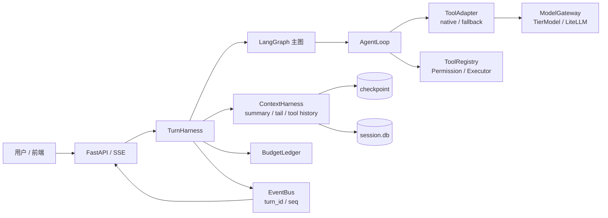

# Knowledge Base System — RAG + Agent Harness

基于 RAG 的知识库问答与多 Agent 执行系统。后端用 LangGraph 编排检索、规划、工具执行与上下文压缩；前端用 Vue 3 + Harness 事件层渲染多 Agent 流式过程。

> 人类入口：本文件。Coding agent 入口：[`AGENTS.md`](AGENTS.md)。
> 架构权威：[`docs/harness-architecture-design.md`](docs/harness-architecture-design.md)。验收/差距：[`docs/harness-design-gap-matrix.md`](docs/harness-design-gap-matrix.md)。

---

## 为什么是 Harness

不同模型对工具调用的支持差异很大：有的原生返回 `tool_calls`，有的只能输出文本。Harness 把差异收在一层：

- **协议适配**：原生 `tool_calls` 与文本定界符两条路径统一成 `ToolCall(id, name, arguments)`。
- **上下文连续**：模型切换时备份原文、压缩摘要、回填精确值、原子写绑定；失败回滚。
- **可控成本**：压缩门禁、扇出门禁、`BudgetLedger`、15 个工具上限。
- **可恢复**：确定性 tool id、`turn_id + seq` 事件、checkpoint 恢复、错误分类与重试。
- **可测**：真实模型 E2E / 性能项与假模型回归分离，默认 CI 不烧 token。

---

## 核心能力

| 能力 | 说明 |
| --- | --- |
| **Agent Harness** | 原生/文本双路径工具调用、历史归一化、流式执行、确定性 tool id |
| **快速寒暄/介绍** | “你好/谢谢/简单介绍/你是谁/你能做什么”走固定模板，不调用模型 |
| **Ollama 兼容** | 原生 tools 与无 tools 文本回退双路径；本地模型默认不设为默认模型 |
| **RAG 混合检索** | 向量 + BM25 + RRF；章节感知分块、父子块展开、grade/rewrite 质量门禁 |
| **多 Agent 编排** | Supervisor → plan/RAG/memory/compress → execute → synthesize；支持串行与并行扇出 |
| **跨模型切换** | 原文快照、摘要迁移、精确值探针、原子提交/回滚、审计 |
| **上下文压缩** | simple tier 摘要 + 规则截断 + 精确值回填 + tail 回放 |
| **工具与权限** | 注册表、scope、15 上限、审批、沙箱、Shell 重定向检查、输出有界化 |
| **成本治理** | BudgetLedger、压缩/扇出门禁、token/cost 统计、预算耗尽事件 |
| **可靠性** | 429/5xx 退避、fallback、取消、断连清理、checkpoint 恢复 |
| **安全** | 密钥脱敏、不可信工具内容隔离、路径/命令/SSRF 防护 |
| **Skills / Plugins** | Markdown 技能与 Python `tool_*` 插件动态扩展 |
| **前端 Harness** | `frontend/src/harness/`：事件契约、legacy adapter、turn reducer、SSE composable |
| **聊天时间线** | opencode 式单一执行时间线；只展示真实工具调用与答案，隐藏图内节点；内联审批/错误、紧凑 Composer |
| **会话与移动端** | 会话树/fork/revert/compact、排队输入、IndexedDB 离线缓存；移动端复用聊天视图 |

---

## 架构简图



前端：

```text
MultiAgentView
  → ConversationTimeline（单一执行时间线，从 agents[].parts 派生）
  → multiAgent store → useHarnessTurn
      → adapter（legacy 归一化）
      → reducer（turn_id + seq、step_id upsert）
      → agents / parts / permission / terminal
  → ChatInput（紧凑 Composer，保留附件/语音/排队/模型/Agent）
```

---

## 快速启动

### 前置

- Python **3.13**（见 `backend/.python-version`）
- Node.js 18+
- 可选：`uv`（更快安装）

### 后端

```powershell
cd backend
# 首次
python -m venv .venv
.venv\Scripts\python.exe -m pip install -r requirements.txt

# 配置
copy config.example.json config.json
# 编辑 config.json，至少填写 llm_api_key / llm_api_base / llm_model

# 启动（约 30–40s；不要用 --reload）
.venv\Scripts\python.exe -m uvicorn app.main:app --host 0.0.0.0 --port 8000
```

就绪检查：

```powershell
Invoke-WebRequest http://127.0.0.1:8000/api/auth/status
```

### 前端

```powershell
cd frontend
npm install
npm run dev
# http://localhost:5173；/api 代理到 127.0.0.1:8000
```

生产构建：

```powershell
npm run build
npm run preview
```

---

## 测试与验收

### 后端

```powershell
cd backend
.venv\Scripts\python.exe -m pytest
.venv\Scripts\python.exe -m pytest tests\unit tests\contract tests\reliability tests\security -q
.venv\Scripts\python.exe -m pytest tests\unit tests\contract tests\reliability tests\security -q --cov=harness
```

### 前端

```powershell
cd frontend
npm test
npm run build
# 先退出 Ollama（托盘退出），设置用户环境变量，再重启 Ollama：
setx OLLAMA_CONTEXT_LENGTH 4096
setx OLLAMA_NUM_PARALLEL 1
setx OLLAMA_MAX_LOADED_MODELS 1
setx OLLAMA_FLASH_ATTENTION 1
setx OLLAMA_KV_CACHE_TYPE q8_0

# 需后端已启动
$env:LIVE_API_BASE='http://127.0.0.1:8000'
npx vitest run tests/integration/
```

### 真实模型（可选，默认 skip）

```powershell
$env:HARNESS_SMOKE_MODEL_A='deepseek/deepseek-v4-flash'
$env:HARNESS_SMOKE_MODEL_B='deepseek/deepseek-v4-pro'
cd backend
.venv\Scripts\python.exe -m pytest tests\integration\test_harness_tool_history_smoke.py tests\perf\test_harness_perf.py -q
```

当前实测（2026-10-24，本地 Windows）：

- 后端：`526 passed, 18 skipped`
- Harness 覆盖率：`90.80%`（门槛 90%）
- 前端单测：`104 passed`
- 前端 live SSE：`119 passed`
- 前端构建：通过
- 真实模型：DeepSeek E2E 8 条、PF-01/02/05/06/07 通过

---

## 配置重点

| 配置项 | 说明 |
| --- | --- |
| `llm_api_key` / `llm_api_base` / `llm_model` | 模型凭证与默认模型 |
| `session_budget` | 会话预算；`0` 表示不限 |
| `max_concurrent_agents` | 并发 Agent 上限 |
| `COMPRESS_THRESHOLD` / `KEEP_RECENT_TOKENS` | `cognition/compressor.py` 模块常量；切换模型时按目标窗口绑定覆盖 |
| `plan_parallel_enabled` | 并行扇出开关（默认关闭） |
| `harness_tool_mode` | `native` / `fallback`，排障强制模式 |
| `harness_smoke_model_a/b` | 真实模型验收模型对 |

配置来源：`backend/config.example.json`（全部参数与默认值）→ 复制为 `backend/config.json`。
优先级：操作系统环境变量 > `config.json` > 代码默认值；`.env` 文件不再读取。

数据根：`agentsuper_data` 留空 = 平台用户目录（Windows `%LOCALAPPDATA%\agentsuper`，macOS `~/Library/Application Support/agentsuper`，Linux `~/.local/share/agentsuper`）；可改为 `D:/agentsuper` 等绝对路径。首次启动会把旧的 `backend/data` 自动拷贝到空数据根（`agentsuper_migrate_legacy=false` 可关闭）。

---

## 目录

```text
backend/      FastAPI + LangGraph + Harness + RAG + 执行/权限
frontend/     Vue 3 + Pinia + Harness 事件层 + 移动端
docs/         设计、差距矩阵、历史方案
deploy/       Nginx/Caddy 部署配置
data root/    运行时数据（会话、检查点、截断输出、模型目录；默认平台用户目录，可用 agentsuper_data 覆盖）
```

---

## 已知边界

- 预算计费目前是**调用后结算**，不是严格调用前预扣（D-01）。
- 真实模型/性能测试默认跳过，需要显式设置模型对与凭证。
- 前端 Harness 设计文档章节尚未补；当前以 `frontend/src/harness/` 与测试为准。
- 旧 `MultiAgentResponse.vue` / `AgentPanel.vue` 仍保留给旧测试与回滚，聊天主视图已改用 `ConversationTimeline.vue`。
- `backend/README.md`、`frontend/README.md` 仍可能落后于根文档。

---

## 文档索引

- [`AGENTS.md`](AGENTS.md)：coding agent 工作手册
- [`docs/harness-architecture-design.md`](docs/harness-architecture-design.md)：Harness v2 设计
- [`docs/harness-design-gap-matrix.md`](docs/harness-design-gap-matrix.md)：G-01~G-16 与验收
- [`docs/agent.md`](docs/agent.md)：总体 Agent/RAG 设计
- [`docs/agent-1.md`](docs/agent-1.md) ~ [`agent-4.md`](docs/agent-4.md)：压缩/检索/切换/工具协议
- [`docs/codeact-sandbox-design.md`](docs/codeact-sandbox-design.md)：CodeAct
- [`docs/移动端聊天交互设计要点-ChatGPT范式.md`](docs/移动端聊天交互设计要点-ChatGPT范式.md)：移动端聊天
