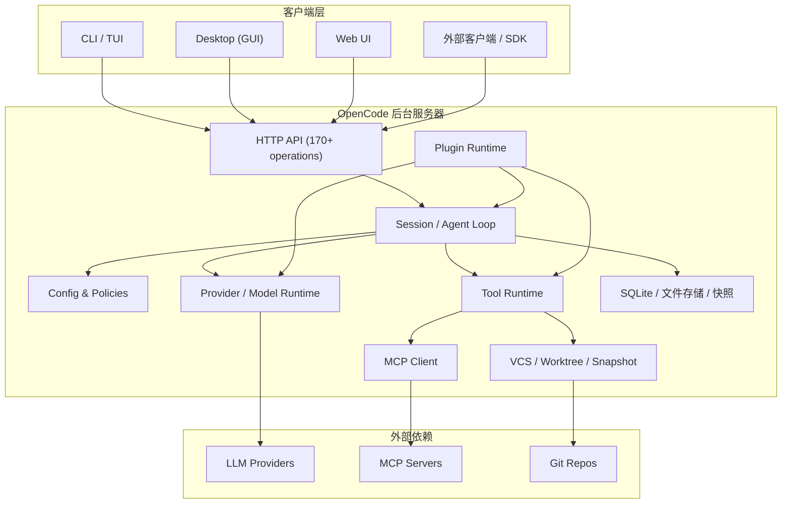

# OpenCode 技术与实现文档

> 来源：<https://opencode.ai/docs>（官方文档 V2，抓取整理日期：2026-11-09）
> 性质：基于官方文档内容整理的技术与实现说明，包含架构归纳与实现要点分析；具体行为以官方文档与源码为准。

---

## 目录

1. [概述](#1-概述)
2. [系统架构](#2-系统架构)
3. [安装与部署](#3-安装与部署)
4. [配置系统](#4-配置系统)
5. [会话、Location 与运行时](#5-会话location-与运行时)
6. [Provider 与模型层](#6-provider-与模型层)
7. [Agent 系统](#7-agent-系统)
8. [工具系统与执行模型](#8-工具系统与执行模型)
9. [MCP 集成](#9-mcp-集成)
10. [权限与策略安全模型](#10-权限与策略安全模型)
11. [上下文管理：压缩、快照、附件、引用](#11-上下文管理压缩快照附件引用)
12. [指令、技能与命令](#12-指令技能与命令)
13. [插件系统](#13-插件系统)
14. [API、Client SDK 与嵌入式 SDK](#14-apiclient-sdk-与嵌入式-sdk)
15. [CLI 命令参考](#15-cli-命令参考)
16. [运维与排错](#16-运维与排错)
17. [实现要点与设计模式](#17-实现要点与设计模式)
18. [参考链接](#18-参考链接)

---

## 1. 概述

OpenCode 是一个开源的编码 Agent（coding agent），提供三种形态：

- **CLI / TUI**：终端全屏交互界面；
- **Desktop**：桌面应用；
- **Web**：浏览器界面（由同一服务器提供）。

核心能力包括：多 Provider 模型接入、Agent（主/子 Agent）、工具调用（文件、Shell、Web、MCP）、权限与策略控制、上下文压缩、文件快照回滚、插件扩展、以及可编程的 HTTP API / SDK。

### 1.1 关键设计取向

- **客户端 / 服务端分离**：会话、配置、插件、权限、工具执行等状态由后台服务器统一持有，多种客户端共享。
- **配置即能力**：几乎全部能力（Provider、Agent、工具、MCP、插件、权限、策略、压缩）均可通过 `opencode.json(c)` 声明。
- **可扩展**：插件可分别运行在 server / TUI / GUI，并通过 RPC 契约跨端调用。
- **安全分层**：`permissions`（每 Agent 的工具规则，可 allow/deny/ask）+ `policies`（二元、只收紧、绝不提示）双轨。
- **上下文可控**：自动/手动压缩、原生 Provider 压缩、快照回滚、附件与引用管理。

---

## 2. 系统架构

### 2.1 总体结构



### 2.2 后台服务模型

默认情况下，OpenCode 为当前用户**发现或启动一个共享后台服务器**。所有本地客户端（TUI、Desktop、Web、SDK）连接到该服务器，由服务器统一拥有：

- 会话（sessions）；
- 配置与策略；
- 集成（integrations）与凭据；
- 权限决策；
- 工具执行。

启动模式：

| 模式 | 行为 |
|---|---|
| 默认（共享服务） | 自动发现/启动用户级共享 server |
| `--standalone` | 启动私有 server，随当前进程生命周期 |
| `--server <url>` | 连接到指定的 server |
| `opencode serve` | 前台运行服务器（适合 systemd/Docker/远程主机） |

禁用共享服务：

```bash
opencode service set disabled true
opencode            # 停止正在运行的共享服务后启动
```

### 2.3 Location（定位）与 Project

- **Location**：一个会话/插件实例所属的工作目录上下文，包含 `directory`、可选 `workspaceID`、以及 `project` 元数据（`id`、`directory`、`canonical`）。
- **Project**：以规范检出目录（canonical checkout）为基准的逻辑项目，可包含多个 worktree。
- 配置、凭据、模型可用性、MCP 连接、插件实例等均具有 **Location 作用域**：一个项目可用的模型在另一个项目可能不可用。

### 2.4 主要数据与状态

| 状态 | 承载位置 |
|---|---|
| 会话与消息 | 数据库（默认 `~/.local/share/opencode/opencode.db`，可由 `OPENCODE_DB` 覆盖） |
| 配置 | `opencode.json(c)`（项目/全局/系统/托管） |
| CLI 设置 | `~/.config/opencode/cli.json` |
| 服务注册信息 | `~/.local/state/opencode/service.json` |
| 服务私有配置 | `~/.config/opencode/service.json` |
| 日志 | `~/.local/share/opencode/log/opencode.log` |
| 快照对象库 | OpenCode 数据目录下独立的内部 Git object database |
| 远程引用检出 | `~/.local/share/opencode/repos/...` |

---

## 3. 安装与部署

### 3.1 CLI 安装方式

| 方式 | 命令 |
|---|---|
| curl | `curl -fsSL https://opencode.ai/v2/install \| bash` |
| Homebrew | `brew install anomalyco/tap/opencode-v2` |
| npm | `npm install -g @opencode/cli` |
| Bun | `bun install -g --trust @opencode/cli` |
| pnpm | `pnpm add -g --allow-build=@opencode/cli @opencode/cli` |
| Yarn | `yarn global add @opencode/cli` |
| Vite+ | `vp install -g @opencode/cli` |
| AUR | `paru -S opencode-beta` |
| mise | `mise use -g opencode`（需 mise ≥ 2026.10.9） |

说明：
- npm 包通过 postinstall 脚本选择对应平台的原生二进制；Bun/pnpm 需显式允许脚本。
- **Windows 包管理器不受支持**（可下载独立二进制）。
- 提供 macOS / Windows / Linux（glibc、musl）各架构的独立二进制。
- Desktop 提供 macOS（dmg）、Windows（exe）、Linux（deb/rpm/AppImage）。
- Docker 使用版本化 tag，例如 `ghcr.io/anomalyco/opencode:2.0.0`。

### 3.2 Web 访问

```bash
opencode pair
# 输出一次性连接链接与二维码，5 分钟内有效
```

- 默认仅监听 localhost；端口：macOS/Linux/WSL 为 `49374`，Windows 为 `28894`。
- 会话 cookie 有效期 30 天；修改服务器密码会使所有会话登出。
- 远程访问：`opencode pair --remote`（经 OpenTunnel，端到端加密，需服务器密码；首次会提示确认）。
- 认证：`OPENCODE_PASSWORD` 固定密码；HTTP Basic 用户名为 `opencode`。

### 3.3 服务管理

```bash
opencode service start
opencode service restart
opencode service status
opencode service stop
opencode service set hostname 0.0.0.0
opencode service set port 49374
opencode service set password "a-long-secret"
opencode service set cors https://app.example.com
opencode service set env OPENCODE_LOG_LEVEL DEBUG
opencode service unset hostname
```

注意：修改服务配置会停止后台服务，需重新 `start` 生效。

---

## 4. 配置系统

### 4.1 配置文件与格式

- 文件名：`opencode.json` 或 `opencode.jsonc`（支持注释与尾逗号）。
- 建议加入 `$schema` 以获得编辑器校验与补全：

```jsonc
{
  "$schema": "https://opencode.ai/config.json",
  "model": "anthropic/claude-sonnet-5-5"
}
```

完整 schema：<https://opencode.ai/config.json>

### 4.2 配置位置与优先级

| 层级 | 路径 | 说明 |
|---|---|---|
| 系统（机器级） | macOS `/Library/Application Support/opencode`；Linux `/etc/opencode`；Windows `%ProgramData%\opencode` | 同时加载 `agents/`、`commands/`、`skills/`、`plugins/` |
| 托管（MDM） | macOS `/Library/Managed Preferences/<user>/ai.opencode.managed.plist` 或机器级 plist | 最高优先级 |
| 全局（用户） | `~/.config/opencode/opencode.json(c)` | 所有项目 |
| 项目 | `<dir>/opencode.json(c)` 或 `<dir>/.opencode/opencode.json(c)` | 从当前目录向文件系统根搜索 |

**合并规则（普通设置）**：

- 从最远目录到最近目录先合并直接 `opencode.json(c)`，再按同样顺序合并 `.opencode` 内文件；
- 因此 `.opencode` 配置总是覆盖同目录的直接配置；
- 系统配置覆盖全部；托管设置覆盖系统目录；
- 不冲突的设置保留。

示例（从 `/home/user/projects/acme/packages/web` 启动）按低→高优先级应用：

1. `~/.config/opencode/opencode.json`
2. `/home/user/projects/acme/opencode.json`
3. `/home/user/projects/acme/packages/web/opencode.json`
4. `/etc/opencode/opencode.json`

> 注意：**Policies 的优先级是反向的**（见第 10 章），全局/系统/托管策略覆盖项目策略。

### 4.3 变量替换

在 JSON 字符串中使用：

```jsonc
{
  "model": "{env:OPENCODE_MODEL}",
  "providers": {
    "anthropic": {
      "settings": { "apiKey": "{env:ANTHROPIC_API_KEY}" }
    }
  },
  "providers_openai_example": {
    "settings": { "apiKey": "{file:~/.secrets/openai-key}" }
  }
}
```

- `{env:NAME}`：未设置时替换为空字符串。
- `{file:path}`：相对配置文件目录、绝对路径或 `~/`；文件不存在时替换为空字符串。
- 用途：把密钥放入独立文件、复用配置片段。

### 4.4 主要配置域一览

| 域 | 关键字段 | 作用 |
|---|---|---|
| 通用 | `$schema`、`shell`、`model`、`default_agent`、`username` | 基础设置 |
| 更新 | `update`: `disable`/`notify`/`auto` | 更新检查（项目级忽略） |
| 权限 | `permissions[]` | 工具规则（allow/deny/ask） |
| 策略 | `policies[]` | 二元强制策略 |
| Agent | `agents{}` | 覆盖内置或自定义 Agent |
| 快照 | `snapshots` | 文件系统快照（undo/redo） |
| 监视 | `watcher.ignore[]` | 忽略文件变更 |
| 格式化 | `formatter` | 写/edit/patch 后格式化 |
| 媒体 | `media.image` | 图片缩放/拒绝 |
| 输出 | `tool_output.max_lines/max_bytes` | 工具结果保留上限 |
| 搜索 | `websearch.provider` | Web 搜索 Provider |
| MCP | `mcp.servers{}`、`mcp.timeout` | MCP 服务器 |
| 压缩 | `compaction` | 自动压缩与保留预算 |
| 预热 | `warming` | 保持模型会话热 |
| 技能 | `skills[]` | 额外技能目录/URL |
| 命令 | `commands{}` | 斜杠命令模板 |
| 指令 | `instructions[]` | 额外指令文件/URL |
| 引用 | `references{}` | 命名外部目录/仓库 |
| Worktree | `worktree.directory` | 新 worktree 父目录 |
| 插件 | `plugins[]` | 包/本地插件 |
| Provider | `providers{}` | Provider 与模型覆盖 |
| 实验 | `experimental` | todo、subagent_depth、background_compaction、image_generate、location_idle_timeout |

### 4.5 实验性配置

```jsonc
{
  "experimental": {
    "todo": true,
    "subagent_depth": 2,
    "background_compaction": true,
    "image_generate": { "model": "openai/gpt-image-2" },
    "location_idle_timeout": "4 hours"
  }
}
```

- `todo`：为 Agent 提供 `todowrite` 工具（默认 `false`）。
- `subagent_depth`：子 Agent 再启动子 Agent 的深度（默认 `1`）。
- `background_compaction`：后台预写压缩摘要（默认 `false`）。
- `image_generate`：`experimental_image_generate` 工具默认模型。
- `location_idle_timeout`：Location 无活动后卸载服务的时长（默认 `60 minutes`，`false` 表示永不卸载）。

### 4.6 CLI 设置（cli.json）

仅控制终端客户端，与服务端/项目配置分离：

```json title="~/.config/opencode/cli.json"
{
  "$schema": "https://opencode.ai/v2/cli.json",
  "theme": { "name": "tokyonight", "mode": "system" },
  "animations": true,
  "cursor": { "style": "block", "blinking": true },
  "mouse": true,
  "scroll": { "speed": 3, "acceleration": false },
  "prompt": { "editor": true, "paste": "compact", "image_preview": false },
  "session": {
    "sidebar": "auto",
    "scrollbar": false,
    "submit_scroll": "bottom",
    "thinking": "hide",
    "grouping": "auto",
    "image_preview": false,
    "tps": true,
    "markdown": "rendered",
    "new_location": "launch",
    "permissions": "prompt"
  },
  "tabs": { "mode": "auto", "scope": "cwd", "layout": "horizontal", "indicators": "status" },
  "diffs": { "source": "branch", "wrap": "word", "tree": true, "single": false, "view": "auto" },
  "attention": { "notifications": true, "sound": true, "volume": 0.4, "sound_pack": "opencode.default" },
  "terminal": { "title": true, "copy": "select" },
  "mini": { "thinking": "show", "tools": "hide", "shell_output": "hide", "turn_summary": "show", "footer": "show", "splash": "show", "work_spinner": "block-soft-slide", "mono": false, "replay": true, "replay_limit": 200 },
  "keybinds": { "leader": "ctrl+x", "app.exit": ["ctrl+c", "ctrl+d", "<leader>q"] },
  "leader": { "timeout": 2000 },
  "plugins": [],
  "debug": { "devtools": false, "timing": false, "turn_tokens": "verbose" },
  "experimental": {}
}
```

- 内联覆盖：`OPENCODE_CLI_CONFIG_CONTENT='{"tabs":{"mode":"off"}}' opencode`
- 未知设置会被忽略；`$schema` 用于编辑器校验。
- 输入方式（TUI）：`Ctrl+P` → **Open settings**。

---

## 5. 会话、Location 与运行时

### 5.1 会话模型

- 会话（Session）属于某个 Location/项目；
- 会话可创建**子会话**（`parentID`），用于 subagent、命令后台执行等；
- 会话可变属性：标题、Agent、模型、权限规则、指令条目等；
- 会话支持：fork（在指定消息前复制历史）、move（移动到另一个项目目录）、export/import、archive 等。

### 5.2 Agent Loop（代理循环）

一次用户输入后的典型流程：

```text
用户 Prompt
  → Prompt 准入（插件 prompt hook、附件/技能解析）
  → 持久化入队（inbox，steer/queue）
  → 组装系统指令 + 历史 + 工具 schema
  → 调用模型（HTTP 或 WebSocket）
  → 解析工具调用 → 权限检查 → 执行工具 → 结果回填
  → 重复（step），直到模型不再调用工具或达到 steps 上限
  → 压缩检查（接近上下文上限时）
```

- `steps`：Agent 可设置正数最大模型步数；最后一步移除工具并要求模型用文本总结。
- 新用户输入会重置步数额度。
- 投递模式：`steer`（默认，在下一步边界插入）与 `queue`（保持队列顺序）。

### 5.3 事件流

- 客户端通过异步迭代器订阅事件：`client.event.subscribe()`、`acme.events.subscribe(...)`。
- 事件为**实时**，不重放、不自动重连；连接失败会结束当前订阅。
- 新订阅者会收到 `server.connected` 标记（插件运行在 server 内，不会收到）。
- 可按类型过滤：`subscribe({ types: ["config.updated"] })`；`server.connected` 始终透传。
- 关键事件包括：`config.updated`、`session.compaction.*`、`worktree.updated`、`shell.started`、`shell.ended`、`location.shutdown`、`rpc.<rpcID>.<event>`。

### 5.4 Worktree

- 每个项目有一个规范检出（canonical checkout），可派生多个 worktree。
- `worktree.directory` 配置新 worktree 的父目录；相对路径相对于项目规范检出解析。
- 未配置时，创建于服务器数据目录下 `worktree/<项目ID前6位>`。
- Git 是内置默认策略；插件可注册自定义 worktree 策略（自动成为该插件运行时的默认策略）。
- 操作：`worktree_create`、`worktree_list`、`worktree_remove`（`force` 丢弃未提交修改），对应 API `worktree.create/list/refresh/remove`。

---

## 6. Provider 与模型层

### 6.1 模型目录

- OpenCode 内置来自 [models.dev](https://models.dev) 的 Provider/模型目录；
- `/connect` 连接账号，`/models` 选择模型；
- 模型引用格式：`provider/model`，可选 `#variant`：

```text
openai/gpt-6.1-sol
openai/gpt-6.1-sol#high
openrouter/anthropic/claude-sonnet-5.5#high
```

规则：Provider 到第一个 `/` 结束；模型可含额外 `/`；变体在 `#` 之后；Provider/模型 ID **大小写敏感**。

### 6.2 Provider 配置结构

```jsonc
{
  "providers": {
    "acme": {
      "name": "Acme",
      "env": ["ACME_API_KEY"],
      "package": "@opencode/ai/providers/openai-compatible",
      "settings": { "baseURL": "https://llm.acme.example/v1" },
      "models": {
        "qwen3-coder": { "name": "Qwen 3 Coder" }
      }
    }
  }
}
```

| 字段 | 作用 |
|---|---|
| `name` | 显示名 |
| `env` | 有序环境变量名，用于提供凭据 |
| `package` | 运行时 Provider 包 |
| `canonical` | 继承其目录默认值的内置 Provider ID |
| `compatibility` | 该 Provider 所有模型共享的 API 兼容性怪癖 |
| `settings` | OpenCode 控制项 + 传给运行时包的 JSON 选项 |
| `headers` | 附加 HTTP 请求头 |
| `body` | 合并进请求体的 JSON 字段 |
| `models` | 按 OpenCode 模型 ID 新增/覆盖模型 |

### 6.3 内置运行时包（部分）

```
@opencode/ai/providers/openai
@opencode/ai/providers/openai/chat
@opencode/ai/providers/openai/responses
@opencode/ai/providers/openai-compatible
@opencode/ai/providers/openai-compatible/responses
@opencode/ai/providers/anthropic
@opencode/ai/providers/anthropic-compatible
@opencode/ai/providers/google
@opencode/ai/providers/google-vertex
@opencode/ai/providers/google-vertex/gemini
@opencode/ai/providers/google-vertex/chat
@opencode/ai/providers/google-vertex/responses
@opencode/ai/providers/google-vertex/messages
@opencode/ai/providers/azure
@opencode/ai/providers/azure/chat
@opencode/ai/providers/azure/responses
@opencode/ai/providers/amazon-bedrock
@opencode/ai/providers/amazon-bedrock/mantle
@opencode/ai/providers/openrouter
@opencode/ai/providers/xai
```

也支持 npm 包（如 `@acme/opencode-provider`）或 `file://` 本地包。

### 6.4 模型字段

| 字段 | 作用 |
|---|---|
| `modelID` | 发送给 Provider 的模型/部署 ID |
| `name` | 显示名 |
| `family` | 分组用模型家族 |
| `type` | 产出类型（`chat`/`image`/`decision`），默认 `chat` |
| `releaseDate` | `YYYY-MM-DD` 或 `YYYY-MM` |
| `package` | 该模型的运行时覆盖 |
| `settings` | 模型级控制项与包专属 JSON 设置 |
| `headers` / `body` | 请求级覆盖 |
| `capabilities` | 工具支持、输入/输出媒体类型、温度、推理控制 |
| `compatibility` | 模型级 API 兼容性（覆盖 Provider） |
| `variants` | 命名变体（各自 `settings`/`headers`/`body`） |
| `cost` | 每百万 token 输入/输出/缓存价格 |
| `limit` | 上下文/输入/输出 token 上限 |
| `disabled` | 从选择中移除 |

自定义模型未在目录中时的回退假设：支持工具、文本+图片输入、文本输出、200k 上下文、32k 输出、未指定输入上限。应显式配置真实值。

### 6.5 变体（Variants）

用于推理强度、token 预算等：

```jsonc
{
  "providers": {
    "openai": {
      "models": {
        "gpt-6.1-sol": {
          "settings": { "reasoningEffort": "medium" },
          "variants": [
            { "id": "fast", "settings": { "reasoningEffort": "low" } },
            { "id": "deep", "settings": { "reasoningEffort": "high", "reasoningSummary": "auto" } }
          ]
        }
      }
    }
  }
}
```

- 变体名称来自模型当前目录元数据；未知变体会产生模型解析错误。
- 可通过 `capabilities.reasoning` 让 OpenCode 自动构建变体：
  - `supported`、`toggle`（添加 `none`）、`effort`（`default` 不添加变体）、`budget`（`min`/`max`）。

### 6.6 兼容性（compatibility）

用于描述被代理的 API 的请求/响应差异：

| 字段 | 作用 | 读取方 | 值/默认 |
|---|---|---|---|
| `reasoningField` | 承载推理内容的 assistant 字段 | OpenAI Chat | 任意字段名（除 role/content/refusal/tool_calls） |
| `requireReasoning` | 每条历史 assistant 消息都发送推理字段 | OpenAI Chat | 默认：设置 `reasoningField` 或 DeepSeek 时为 `true` |
| `maxTokensField` | 输出 token 限制字段 | OpenAI Chat | `max_completion_tokens` 或 `max_tokens` |
| `requireFinishReason` | 流缺少 `finish_reason` 视为错误 | OpenAI Chat | 默认 `true` |
| `requireAssistantAfterTool` | 工具结果与下一条用户消息间插入 assistant | OpenAI Chat | Mistral 家族默认 `true` |
| `supportsPromptCacheKey` | 是否接受 `prompt_cache_key` | OpenAI Chat/Responses、Mistral | 布尔 |
| `streamUsage` | 通过 `stream_options.include_usage` 请求用量 | OpenAI Chat | 默认 `true` |
| `cacheFormat` | 提示缓存标记语法 | 多 API | `anthropic` / `alibaba` |
| `supportsThinkingBlockBinding` | 丢弃上下文已变化的 thinking block | Anthropic Messages、Bedrock Converse | Claude 5.1+ 自动检测 |
| `supportsEffortUpdates` | 推理强度作为逐消息更新 | Anthropic Messages、OpenAI Responses | GPT-6+ / Claude Opus 5 等自动检测 |
| `mediaInput` | 图片等媒体在决策请求中的位置 | System One | `assets`/`state`/`root` |

### 6.7 提示缓存

- Anthropic 等已知路由自动放置缓存断点。
- 通过 OpenAI 兼容代理（如 LiteLLM）服务 Claude 时需显式：

```jsonc
{
  "models": {
    "claude-sonnet-5-5": {
      "compatibility": { "cacheFormat": "anthropic" }
    }
  }
}
```

会为 **最后一个工具定义、系统提示、最新消息** 标注 `cache_control: { "type": "ephemeral" }`（默认 5 分钟）。

### 6.8 请求传输与超时

- HTTP 默认：等待响应头 5 分钟，流式分块间隔 15 分钟。
- `settings.headerTimeout` / `settings.chunkTimeout`（毫秒，`false` 禁用）；`settings.timeout` 限制整个请求。
- 超时请求最多重试 3 次。
- WebSocket 传输（OpenAI、xAI、支持的 Azure Responses）：每会话保持一条连接，连续步骤复用未变前缀，仅发送新增内容；`chunkTimeout` 默认 30 分钟。
- 请求编码：`settings.encoding` = `"zstd"` / `"gzip"` / `"none"`；仅对能解码的端点启用。

### 6.9 主要 Provider 接入

| Provider | 关键点 |
|---|---|
| OpenCode Go | $10/月订阅，`/connect` 选 OpenCode Go 并粘贴 API Key |
| ChatGPT | 使用 Plus/Pro 计划；上下文默认上限：GPT-6.1 Sol 及更新 500k，旧模型 272k；可用 `"-opencode.provider.openai-context-caps"` 关闭 |
| Azure | `settings.resourceName` 或 `AZURE_RESOURCE_NAME`；部署列表后台加载；模型 ID 为部署名（小写） |
| Amazon Bedrock | AWS 默认凭据链；`profile`/`region`；`AWS_BEARER_TOKEN_BEDROCK` |
| Google Vertex | ADC + `project`/`location`；环境变量 `GOOGLE_VERTEX_PROJECT` 等 |
| GitHub Copilot | 设备 OAuth，需 Copilot Chat 权限 |
| Ollama | 探测 `http://127.0.0.1:11434`，仅保留具备 `completion` 能力的模型 |
| LM Studio | 默认 `http://127.0.0.1:1234/v1`，从 `/api/v1/models` 发现 |
| vLLM | 默认 `http://127.0.0.1:8000/v1`，先检查 `/health`，发现的模型默认禁用工具 |
| OpenRouter | 原生运行时与目录；保留原生包以维持 OpenRouter 请求/推理行为 |
| 自定义网关 | 用 OpenAI 兼容包 + `models` 显式列模型 |

---

## 7. Agent 系统

### 7.1 Agent 定义

Agent 将 **系统提示 + 模型偏好 + 权限 + 显示信息** 组合成命名助手。

Markdown 形式（`.opencode/agents/<name>.md` 或 `~/.config/opencode/agents/<name>.md`）：

```md
---
description: Reviews changes for correctness and regressions
mode: subagent
model: anthropic/claude-sonnet-5-5#high
permissions:
  - action: edit
    resource: "*"
    effect: deny
  - action: shell
    resource: "*"
    effect: deny
---

Review the current changes. List findings in severity order with file and line references.
```

- Markdown body 成为 `system` 提示；
- 嵌套路径成为 Agent ID 一部分：`.opencode/agents/team/reviewer.md` → `team/reviewer`。

JSONC 形式：

```jsonc
{
  "agents": {
    "reviewer": {
      "description": "Reviews current changes",
      "mode": "subagent",
      "system": "Report findings in severity order.",
      "permissions": [{ "action": "edit", "resource": "*", "effect": "deny" }]
    }
  }
}
```

### 7.2 模式（mode）

| 模式 | 行为 |
|---|---|
| `primary` | 作为会话主 Agent；新自定义 Agent 默认 |
| `subagent` | 仅通过 `subagent` 工具在子会话运行 |
| `all` | 两者皆可 |

子 Agent 以全新上下文在前台或后台子会话运行；父 Agent 的 `subagent` 权限控制可启动哪些 Agent，子 Agent 使用自己的配置权限。

### 7.3 内置 Agent

| Agent | 模式 | 用途 |
|---|---|---|
| **Build** (`build`) | primary | 默认编码 Agent；允许工作区外工具与访问；敏感环境文件读取需批准 |
| **Plan** (`plan`) | primary | 探索与规划，不编辑普通项目文件；可写 OpenCode plan 文件；shell 受权限控制 |
| **General** (`general`) | subagent | 研究与多步工作，工具访问广，但不能启动更多子 Agent |
| **Explore** (`explore`) | subagent | 搜索与阅读代码/Web，不编辑文件 |

隐藏维护 Agent：`compaction`、`title`、`summary`（不可直接选择）。V2 无内置 `scout`。

同名条目可覆盖内置 Agent。

### 7.4 合并规则

- 按配置顺序合并；
- 后者标量替换前者；
- 请求映射按 key 合并；
- 权限规则追加（全局规则先于 Agent 规则，后者可细化）。

### 7.5 主要选项

| 选项 | 说明 |
|---|---|
| `description` | 用途说明；子 Agent 应提供（模型据此选择） |
| `mode` | `primary`/`subagent`/`all` |
| `model` | `provider/model[#variant]`；JSON 也支持展开对象 |
| `system` | 系统提示；非空值替换该 Agent 的 Provider 基础提示 |
| `permissions` | 有序规则列表 |
| `steps` | 正数最大模型步数；最后一步移除工具并要求总结 |
| `hidden` | 从列表/发现/子 Agent 目录隐藏（仅可见性，非安全） |
| `color` | UI 颜色（六位十六进制） |
| `disabled` | 在该配置点移除内置/自定义 Agent |
| `request` | 每 Agent header/body 覆盖（V2 保存但尚未随模型请求发送） |

> V2 不要使用旧版顶层字段：`temperature`、`top_p`、`prompt`、`permission`、`tools`、`disable`、`maxSteps`。

---

## 8. 工具系统与执行模型

### 8.1 工具目录

| 类别 | 工具 | 关键行为 | 权限 action |
|---|---|---|---|
| 文件 | `read` | 读取文件或非递归目录；文本 2000 行/50 KiB/页；图片/PDF 最多 20 MiB | `read`（规范化路径） |
| 文件 | `glob` | 按模式查找路径；默认 100 个、30 秒超时 | `glob`（模式） |
| 文件 | `grep` | 正则内容搜索；默认 100 行、30 秒超时 | `grep`（模式，不是路径） |
| 文件 | `edit` | 精确替换（默认唯一匹配） | `edit`（目标路径） |
| 文件 | `write` | 创建或完全替换文件 | `edit`（目标路径） |
| 文件 | `patch` | 多文件增删改/移动；仅部分 GPT 模型暴露 | `edit`（每个路径） |
| 命令 | `shell` | 在宿主 shell 执行；`workdir`、`timeout`、`background` | `shell`（扫描器产出的命令） |
| Web | `webfetch` | 获取 HTTP(S) 为 markdown/text/html；超时 ≤120s | `webfetch`（URL） |
| Web | `websearch` | 通过选定 Provider 搜索 | `websearch`（query） |
| 图像 | `experimental_image_generate` | 生成/编辑图片，后台运行 | `experimental_image_generate`（模型） |
| 交互 | `question` | 暂停并提问（单选/多选/自由回答） | `question` |
| 交互 | `skill` | 加载技能指令与资源 | `skill`（技能 ID） |
| 自动化 | `subagent` | 启动子会话；可 `background: true` | `subagent`（Agent ID） |
| 自动化 | `execute` | Code Mode 中运行 JavaScript，组合调用工具 | `execute`（`*`） |
| 扩展 | `<server>_<tool>` | MCP 工具 | `<server>_<tool>` |
| 资源 | `list_mcp_resources` / `read_mcp_resource` | MCP 资源 | `opencode_list_mcp_resources` / `opencode_read_mcp_resource` |

### 8.2 Code Mode 与 execute

- `execute` 在 Code Mode 中运行 JavaScript，运行时**无直接文件系统、import、定时器**，仅提供 `fetch` 和工具目录。
- 适合并行独立调用、处理中间结果而无需把每个中间值放入模型上下文。
- 拒绝 `execute`（资源 `*`）会移除 Code Mode 及仅通过它到达的工具（包括未设置 `codemode: false` 的 MCP 工具）。
- 嵌套内置/MCP 工具仍执行各自权限；插件工具执行其声明的权限。

Code Mode 命名空间：
- `opencode`：`session_rename`、`session_move`、`worktree_create`、`worktree_list`、`worktree_remove`。
- `browser`：控制 Desktop 附加浏览器（tab、导航、快照、点击、表单、截图、文件传输、控制台/网络检查、性能 trace、堆检查、Lighthouse）。页面内容/日志/响应体是**不可信数据**，不是 Agent 指令。

### 8.3 Shell 权限扫描器

- 覆盖 Bash、Zsh、POSIX `sh`、PowerShell；
- 对语法错误或无法安全分析的动态求值，返回扫描错误而非执行未验证子命令；
- 权限规则、已保存批准模式、尽力而为的目录推断应用于每个提取出的子命令与 `cd` 目标；
- Shell 拥有宿主用户的文件系统/进程/网络权限，应使用窄白名单。

### 8.4 工具结果与输出限制

- 工具结果默认保留 `max_lines: 2000`、`max_bytes: 51200`（`tool_output` 可配）；
- 大输出被截断，完整内容保存在受管文件中；
- 后台 `shell` 调用立即返回，完成时通知会话，默认无超时（除非指定）。

---

## 9. MCP 集成

### 9.1 架构

OpenCode 作为 MCP 客户端连接 Model Context Protocol 服务器，暴露 tools、prompts、resources、instructions。

- 本地服务器：MCP stdio 传输，由 OpenCode 启动命令。
- 远程服务器：MCP Streamable HTTP，需绝对 URL。
- 默认通过 **Code Mode** 暴露 MCP 工具（按规范化服务器名分组，如 `tools.context_7.resolve_library_id(...)`）；设置 `codemode: false` 可直接列入 Provider 原生工具列表。

### 9.2 配置

```jsonc
{
  "mcp": {
    "timeout": { "startup": 45000, "catalog": 30000, "execution": 600000 },
    "servers": {
      "everything": {
        "type": "local",
        "command": ["npx", "-y", "@modelcontextprotocol/server-everything"],
        "cwd": ".",
        "environment": { "LOG_LEVEL": "info", "MCP_API_KEY": "{env:MCP_API_KEY}" },
        "protocol": "auto",
        "pool": true
      },
      "context7": {
        "type": "remote",
        "url": "https://mcp.context7.com/mcp",
        "headers": { "CONTEXT7_API_KEY": "{env:CONTEXT7_API_KEY}" }
      }
    }
  }
}
```

本地字段：`type`、`command`、`cwd`、`environment`、`disabled`、`codemode`、`timeout`、`protocol`、`pool`。
远程字段：`type`、`url`、`headers`、`oauth`、`disabled`、`codemode`、`timeout`、`protocol`、`pool`。

### 9.3 OAuth

- 远程服务器默认启用 OAuth：发现授权服务器、PKCE 登录、刷新 token；凭据存储在项目配置之外。
- 客户端注册优先级：预注册客户端（`oauth.client_id`）→ CIMD（Client ID Metadata Document）→ DCR（动态客户端注册）。
- 预注册字段（snake_case）：`client_id`、`client_secret`、`scope`、`callback_port`、`redirect_uri`、`auth_server_metadata_url`。
- 远程/SSH 场景：浏览器无法回到 OpenCode 时，从地址栏复制回调 URL 粘贴到登录提示。
- 命令：`opencode mcp auth [name]`、`opencode mcp logout <name>`。

### 9.4 超时

| 超时 | 默认 | 适用 |
|---|---|---|
| `startup` | 30s | 传输连接与服务器初始化 |
| `catalog` | 30s | 列出 tools/prompts/resources/templates |
| `execution` | 12h | 工具调用、prompt 获取、资源读取 |

### 9.5 协议版本

| 值 | 行为 |
|---|---|
| `legacy`（默认） | 经典 `initialize` 握手，支持到 2025-11-25 |
| `auto` | 用 `server/discover` 探测 2026-07-28，不支持则回退 legacy |
| `2026-07-28` | 强制新版本，旧服务器失败 |

### 9.6 共享连接（pool）

- 仅 2026-07-28 版本的连接可共享；`pool: true` 且未设 `protocol` 时视为 `auto`。
- 共享条件：改变连接的所有因素一致（URL/headers/OAuth/账号；命令/cwd/env；timeout/protocol）。
- 本地服务器仅在**本机**目录间共享，跨项目需固定 `cwd`（如 `"~"`）。
- 共享连接无 roots；最后一个使用目录关闭时连接关闭。

### 9.7 命名与资源

- 工具名：`<server>_<tool>`，非字母/数字/`_`/`-` 字符替换为 `_`。
- MCP prompt 变为命令 `<server>:<prompt>`，例如 `/context_7:find_docs`。
- 资源工具：`list_mcp_resources`、`read_mcp_resource`。

### 9.8 服务器指令与上下文

- 服务器在初始化时返回的 instructions 会加入系统提示 `<mcp_instructions>`。
- 若 Agent 权限拒绝该服务器全部工具，或拒绝使用 Code Mode 服务器的 `execute`，则省略其指令。
- 会话调用的 `CallToolRequest.params._meta["ai.opencode/sessionID"]` 携带会话 ID（不透明关联值，不可用于认证）。

---

## 10. 权限与策略安全模型

### 10.1 Permissions（每 Agent 工具规则）

每条规则三字段：

| 字段 | 含义 |
|---|---|
| `action` | 工具权限动作 |
| `resource` | 路径、命令、URL、query、技能 ID、Agent ID 等 |
| `effect` | `allow` / `deny` / `ask` |

- **最后匹配的规则生效**（先写宽泛规则，再写例外）。
- 无规则匹配时默认 `ask`。
- 通配符：`*` 匹配零或多个字符（含 `/`）；`?` 匹配一个字符；其他为字面量。
- Shell 模式以 ` *` 结尾时也匹配无参数命令（`git status *` 匹配 `git status` 与 `git status --short`）。
- 路径规范化：反斜杠转 `/`；Windows 大小写不敏感。
- 多资源操作：任一 `deny` 即拒绝；否则任一 `ask` 即询问；否则允许。

示例：

```jsonc
{
  "permissions": [
    { "action": "shell", "resource": "*", "effect": "ask" },
    { "action": "shell", "resource": "git status *", "effect": "allow" },
    { "action": "shell", "resource": "git diff *", "effect": "allow" },
    { "action": "shell", "resource": "git push *", "effect": "deny" }
  ]
}
```

### 10.2 默认基线策略

每个 Agent（含自定义）起始于：

```jsonc
[
  { "action": "*", "resource": "*", "effect": "allow" },
  { "action": "read", "resource": "*.env", "effect": "ask" },
  { "action": "read", "resource": "*.env.*", "effect": "ask" },
  { "action": "read", "resource": "*.env.example", "effect": "allow" }
]
```

内置 Agent 追加：

| Agent | 追加策略 |
|---|---|
| `build` | 允许提问 |
| `plan` | 允许提问；除 `~/.opencode/plan` 外拒绝编辑 |
| `general` | 拒绝提问与启动子 Agent |
| `explore` | 除 shell、read、glob、grep、webfetch、websearch、external_directory 外全部拒绝；`.env` 读取询问 |
| `title`/`summary` | 拒绝所有动作 |
| `compaction` | 保持基线 |

### 10.3 external_directory

- 位于活动 Location 与其非根项目 worktree 之外的路径，在 `read`/`edit` 规则前先检查 `external_directory`。
- **默认允许**（因此默认不会提示外部访问）。
- 要改为询问：

```jsonc
{ "permissions": [{ "action": "external_directory", "resource": "*", "effect": "ask" }] }
```

- `~`、`~/`、`$HOME`、`$HOME/` 会在配置加载时展开（`external_directory`/`read`/`edit`）；Shell 资源不展开。

### 10.4 批准（approvals）

当规则解析为 `ask`：

| 选择 | 回复 | 结果 |
|---|---|---|
| Allow once | `once` | 仅批准待处理请求 |
| Allow always | `always` | 批准并保存该工具提出的模式为项目级 `allow` |
| Reject | `reject` | 拒绝并拒绝该会话其余待处理请求 |

- 保存的批准是持久的、项目级的 `allow` 规则，**永不覆盖已配置的 `deny`**。
- 工具自行提出保存模式：部分提 `*`，shell 提命令前缀，skills/subagents 提 ID。

### 10.5 Policies（强制策略）

- 与 permissions 分离：**二元、绝不提示、只会收紧**。
- 三层字段：

| 字段 | 值 |
|---|---|
| `action` | `provider.use`、`tool.use`、`integration.connect`、`integration.use`、`mcp.use`、`skill.use`、`plugin.use`、`websearch.use` |
| `resource` | 字符串或通配符 |
| `effect` | `allow` / `deny` |

- **最后匹配生效**；无匹配时允许。
- 无效语句会被丢弃并在服务器日志告警。

示例：

```jsonc
{
  "policies": [
    { "action": "provider.use", "resource": "*", "effect": "deny" },
    { "action": "provider.use", "resource": "anthropic", "effect": "allow" },
    { "action": "tool.use", "resource": "shell:git push *", "effect": "deny" },
    { "action": "tool.use", "resource": "edit:*.env", "effect": "deny" },
    { "action": "mcp.use", "resource": "github", "effect": "allow" },
    { "action": "plugin.use", "resource": "opencode-acme-cli", "effect": "deny" }
  ]
}
```

`tool.use` 资源格式为 `<action>:<value>`，在权限规则与保存批准之后执行，能把 `allow`/`ask` 变为 `deny`，但 `allow` 从不授予访问（只解除更早的宽泛 `deny`）。

### 10.6 策略优先级（与普通设置相反）

| 等级 | 来源 |
|---|---|
| 1（最高） | macOS 托管偏好 plist |
| 2 | 系统 `opencode.json(c)` |
| 3 | 已连接的 Console workspace |
| 4 | 全局 `~/.config/opencode/opencode.json(c)` |
| 5 | 直接 `opencode.json(c)`（外层优先于内层） |
| 6（最低） | `.opencode/opencode.json(c)`（外层优先于内层） |

含义：仓库不能重新启用全局拒绝的 Provider；组织 `deny` 不能被仓库/用户 `allow` 解除。

### 10.7 安全边界说明

- Policies **不**配置端点/凭据，也不能让不可用 Provider 变可用。
- Policies **不**沙箱化插件代码；被拒绝 Provider 在正常 Provider/模型路径上被阻断。
- `hidden`（Agent）与 `references.hidden` 只影响可见性，不是安全机制。

---

## 11. 上下文管理：压缩、快照、附件、引用

### 11.1 上下文压缩（Compaction）

接近模型上下文上限时，OpenCode 总结整个当前对话，并保留最近约 15k token：

```text
before   [ system prompt ][ older conversation ............ ][ recent 15k ][ pending work ]
request  [ system prompt ][ older conversation ............ ][ recent 15k ][ summary instructions ]
after    [ system prompt ][ summary of older + recent ][ recent 15k ][ pending work ]
```

配置：

```jsonc
{
  "compaction": {
    "auto": true,
    "keep": { "tokens": 15000 },
    "buffer": "15%"
  }
}
```

| 字段 | 默认 | 行为 |
|---|---|---|
| `auto` | `true` | 接近上限自动压缩；Provider 报“过长”时恢复一次；手动始终可用 |
| `keep.tokens` | `15000` | 摘要旁保留的近期对话近似 token |
| `buffer` | `"15%"`（至少 16k） | 模型窗口保留空闲比例；达到其余部分时开始压缩 |

`buffer` 接受 `"1%"`–`"99%"`（含小数），也接受 token 数；token 数 ≥ 模型窗口时忽略并使用默认。

压缩模型：

```jsonc
{ "agents": { "compaction": { "model": "anthropic/claude-sonnet-5-5" } } }
```

无法解析时回退到会话模型。

**原生 Provider 压缩**：

```jsonc
{
  "providers": {
    "openai": {
      "settings": { "compaction": { "type": "native" } },
      "models": {
        "gpt-6.1-sol": { "settings": { "compaction": { "type": "summary" } } }
      }
    }
  }
}
```

- `native` 使用 Provider 压缩端点，返回不透明加密项替代旧对话；保留最近 user 消息至 `keep.tokens`。
- 加密检查点仅对同一 Provider/模型有效；切换模型则从原始对话继续。

**后台压缩（实验性）**：`experimental.background_compaction: true`，在阈值前预写摘要并暂存，到阈值时换入；若从未使用仍消耗 token；摘要保存在内存，重启丢失。

**限制**：压缩需要可替换的旧对话；若请求主要由固定指令与工具 schema 组成则无法腾出空间。第二次“过长”拒绝会作为错误返回。

### 11.2 快照（Snapshots）与撤销

- 每个模型步骤在模型调用前尝试快照 A，步骤成功/失败后快照 B；assistant 消息记录变化路径。
- 覆盖会话活动目录（位于 Git worktree 内）：已跟踪文件、≤2 MiB 的非忽略未跟踪文件；不覆盖 Git 忽略文件、>2 MiB 未跟踪文件、活动目录外文件、Git 元数据等。
- 存储于 OpenCode 数据目录下独立的内部 Git object database，不创建提交、不移动分支。
- 命令：`/undo`（`<leader>u`）、`/redo`（`<leader>r`）。
- 配置：`snapshots: false` 停止未来捕获（已存快照不删除）。
- **安全提醒**：快照是便利功能，不是事务/备份；Shell 可能改变服务、进程、网络、数据库、Git 状态、忽略输出或活动目录外文件，回滚不会撤销这些影响。

### 11.3 附件（Attachments）

- V2 输入用 `uri` + 可选 `name`/`description`：

```json
{
  "uri": "file:///home/me/project/src/server.ts?start=20&end=60",
  "name": "server.ts",
  "description": "HTTP server entrypoint"
}
```

- 支持：UTF-8 文本、目录（非递归列表）、PNG/JPEG/GIF/WebP、PDF。
- SVG 按文本处理；AVIF/BMP/音频/视频等二进制不进入模型请求。
- 限制：单项解码后 20 MiB；Desktop 选择总 20 MiB；HTTP(S) 附件 URL 不支持。
- 图片处理配置：

```jsonc
{
  "media": {
    "image": {
      "auto_resize": true,
      "max_width": 2000,
      "max_height": 2000,
      "max_base64_bytes": 5242880
    }
  }
}
```

`auto_resize: true` 保持宽高比缩放到尺寸限制，并尝试更小的 PNG/JPEG 编码直到满足 Base64 限制；`false` 则超限即失败。图片设置是处理限制，不是上传/安全边界。

### 11.4 引用（References）

为当前项目之外的目录/仓库提供**命名访问**：

```jsonc
{
  "references": {
    "docs": {
      "path": "../product-docs",
      "description": "Use for product behavior and terminology"
    },
    "effect": {
      "repository": "Effect-TS/effect",
      "branch": "main"
    }
  }
}
```

- 本地：`path`（相对配置文件目录 / 绝对 / `~/`）；字符串简写仅在以 `.`、`/`、`~` 开头时视为本地路径。
- Git：`repository`（GitHub `owner/repo`、Git URL、host/path、SCP 风格）、可选 `branch`；不支持本地 `file:` 仓库。
- 存储：`<data>/repos/<host>/<repo-path>[@<branch>]`；默认分支检出。
- 刷新：缺仓异步克隆；已有检出在引用加载/重载及新 prompt 准入后后台检查；距上次尝试 ≥24h 才刷新。
- 权限：引用不授予额外工具权限；外部访问仍受 `external_directory` 与 `edit` 等规则约束。
- 别名不能为空，且不能含 `/`、`\`、空白、反引号、逗号。

---

## 12. 指令、技能与命令

### 12.1 指令（AGENTS.md / instructions）

- V2 **只识别 `AGENTS.md`**，不以 `CLAUDE.md` 作为回退。
- 加载：全局 `~/.config/opencode/AGENTS.md` + 从当前工作区目录向 home 的每个 `AGENTS.md`（工作区在 home 外则止于项目根）。
- 组合顺序示例：

```text
~/.config/opencode/AGENTS.md
packages/web/AGENTS.md
packages/AGENTS.md
AGENTS.md
```

- 工作区以下的嵌套 `AGENTS.md` 在 Agent 探索该区域时按“最近优先”加载并去重。
- 可在会话运行中编辑全局/向上发现的 `AGENTS.md`，下一请求前检测变化并插入指令更新。
- 配置追加：

```jsonc
{
  "instructions": ["CONTRIBUTING.md", "docs/guidelines/*.md", "~/rules/opencode.md", "https://example.com/instructions.md"]
}
```

- 相对路径/glob 从工作区向项目根逐目录搜索；HTTP(S) 5 秒超时；缺失文件跳过。
- 系统提示组装顺序：Agent/Provider 系统提示 → Code Mode 工具指导 → MCP/引用/技能指导 → AGENTS.md 与配置指令 → 日期与环境 → API 提供的会话指令条目。

### 12.2 技能（Skills）

- 目录：`.opencode/skills/<skill-id>/SKILL.md`（推荐）或根级 `*.md`。
- 自动发现位置：

| 范围 | 来源 |
|---|---|
| 全局 | `~/.config/opencode/skills` |
| 全局兼容 | `~/.claude/skills`、`~/.agents/skills` |
| 项目 | `.opencode/skills` |
| 项目兼容 | `.claude/skills`、`.agents/skills` |

- `SKILL.md` frontmatter：`name`（显示名）、`description`（模型发现用）、`metadata.opencode/autoinvoke: false` 或 `disable-model-invocation: true`（不向模型广告，但仍可按 ID 显式加载）。
- **技能 ID 由文件路径决定**，不是 frontmatter `name`：`teams/release/SKILL.md` → `release`。
- 每个模型步骤只列出有 description 且未禁用自动调用的技能（仅 ID/name/description）；模型用 `skill` 工具加载完整正文。
- 也可在 prompt 中用 `@skill-id` 手动加载。
- 加载流程：选当前定义 → 检查 Agent `skill` 权限 → 加入去掉 frontmatter 的正文 → 提供技能基目录与最多 10 个支持文件路径示例。
- 优先级（低→高）：内置 → `.claude/skills` → `.agents/skills` → `~/.config/opencode/skills` → 项目 `.opencode/skills` → 显式 `skills` 配置。

### 12.3 命令（Commands）

- 文件：`~/.config/opencode/commands/*.md`、`.opencode/commands/*.md`；仅 `.md`；嵌套路径成为命令名（`/team/review`）。
- 正文即模板；frontmatter 可含：

| 字段 | 行为 |
|---|---|
| `template` | 仅 JSON |
| `description` | 列表/发现显示 |
| `agent` | 运行命令时选择的 Agent |
| `model` | `provider/model[#variant]` 覆盖 |
| `subagent` | `true` 后台子会话；`false` 强制当前会话 |
| `subtask` | 已弃用别名（`subagent` 优先） |

参数：
- `$ARGUMENTS`：完整参数字符串；
- `$1`、`$2`…：位置参数（单/双引号分组并移除）；最高位占位符吞掉其后所有参数；缺失位置为空串。
- 无占位符时，非空参数附加在空行之后。

Shell 注入：

```md
Review this diff:

!`git diff --stat && git diff`
```

- `!` + 反引号，输出在提交 prompt 前插入；先展开参数占位符。
- **警告**：Shell 块在 Agent 工具权限流程之外执行，只使用可信来源。

---

## 13. 插件系统

### 13.1 插件组成（Parts）

一个插件包可包含任意组合的四个部分：

```json title="package.json"
{
  "name": "opencode-acme-plugin",
  "version": "1.0.0",
  "type": "module",
  "exports": {
    ".": "./src/index.ts",
    "./tui": "./src/tui.tsx",
    "./gui-experimental": "./dist/gui-experimental.cjs",
    "./rpc": "./src/rpc.ts"
  },
  "files": ["src", "dist"],
  "dependencies": { "@opencode/plugin": "latest" }
}
```

| Part | 入口 | 运行时 | 能力 |
|---|---|---|---|
| Server | `.` / `./server` | OpenCode server | 工具、hooks、集成、命令、Agent |
| TUI | `./tui` | 终端 UI | 命令、路由、slot、Markdown 渲染器 |
| GUI | `./gui-experimental` | Desktop（每窗口 `setup` + 主进程 `main`） | 面板、命令、设置页、原生集成 |
| RPC | `./rpc` | 类型契约 | Server 实现，其他部分/客户端调用 |

- Server 部分的 `Plugin.define` 提供插件 `id`；只有 GUI 部分的包用包名/目录名作 id。
- 一个 `plugins` 条目加载所有部分；TUI 只加载其 server 加载插件的 TUI 部分；Desktop 加载全局配置中插件的 GUI 部分。

### 13.2 加载与发现

```jsonc
{
  "plugins": [
    "opencode-acme-plugin",
    "opencode-acme-plugin@1.2.0",
    "@acme/opencode-plugin",
    "./plugins/local",
    "../shared/plugin",
    "/absolute/path/plugin",
    "file:///home/me/plugins/local",
    { "package": "@acme/opencode-plugin", "options": { "agent": "reviewer", "strict": true } }
  ]
}
```

- 相对路径相对于包含该条目的配置文件。
- 本地路径必须是目录；单文件路径被跳过。
- 自动发现：每个 `.opencode/plugins/` 下的直接 `.ts`/`.js` 文件与直接插件包目录；全局为 `~/.config/opencode/plugins/`。
- 控制：`-` 前缀禁用，`*` 全部，`.*` 匹配 ID 前缀；后出现的 ID 可重新启用。

```jsonc
{ "plugins": ["*", "-opencode.provider.*", "opencode.provider.openai", "-acme.reviewer"] }
```

- 两个内置插件忽略移除：`opencode.config.policy` 与 `opencode.provider.opencode`（Console 连接，传递组织策略）。

### 13.3 生命周期

```ts
import { Plugin } from "@opencode/plugin"

export default Plugin.define({
  id: "example",
  setup(ctx) {
    console.log(`loaded in OpenCode ${ctx.app.version}`)
    return () => console.log("unloaded")
  },
})
```

- `setup` 在加载时运行，可返回清理函数。
- 插件上下文本质是 OpenCode server client，额外提供 transforms、runtime hooks、reload、registrations、options。
- `ctx.location` 提供该插件实例的 location（`directory`、可选 `workspaceID`、`project` 元数据）。

### 13.4 Transforms（同步领域状态编辑）

- Transforms 同步编辑领域状态，后续注册基于之前的注册；
- 注册/移除/`reload()` 标记 registry 变更，下次读取时按注册顺序重放所有活跃 transform 到新值；
- 应按顺序、可重复、开销小。

覆盖领域：

| 领域 | API |
|---|---|
| Agent | `ctx.agent.transform`（list/get/default/update/remove/reload） |
| Provider | `ctx.provider.transform`（add/update/remove/models.set/update/remove/reload） |
| Model | `ctx.model.transform`（list/get/update/remove/default/provider/reload） |
| Command | `ctx.command.transform`（add/reload） |
| Integration | `ctx.integration.transform`（update/remove/method/reload、connect.oauth/command） |
| MCP | `ctx.mcp.transform`（set/update/remove/reload） |
| Reference | `ctx.reference.transform`（add/remove/reload） |
| Skill | `ctx.skill.transform`（add/update/remove/reload） |
| Tool | `ctx.tool.transform`（namespace/add/update/remove/reload） |
| VCS | `ctx.vcs.transform`（add/default） |
| Worktree | `ctx.worktree.transform`（add） |
| WebSearch | `ctx.websearch.transform`（add/default） |

### 13.5 Hooks（拦截实时操作）

- 在领域上注册 hook，返回 registration，可 dispose。
- 多个插件注册同一 hook 时按插件顺序运行，后者可见前者修改。

Session hooks：
- `prompt`：在附件/技能解析与持久化准入前拦截用户输入（可改 text/files/metadata/delivery）。
- `context`：Agent loop 模型请求前修改系统指令、消息、工具、请求选项。
- `compaction`：压缩摘要请求；可设 `result` 自行记录并跳过模型调用。
- `generate`：`ctx.session.generate` 的临时调用。
- `title`：标题生成；可设 `result`。
- `model.request`：修改模型请求设置（可按 provider 作用域）。
- 原生 HTTP hooks：修改 Provider 原生请求/响应（body 是一次性流，需 clone/replace）。

请求覆盖规则：
- `options` 每次模型调用从空开始，不包含已解析模型设置；
- 类型化 key 为生成设置，其他 key 作为 Provider 选项传给所选协议；
- 覆盖优先级：请求覆盖 > 模型默认 > 路由默认；
- Provider 选项对象递归合并，数组/标量替换；
- 删除或设为 `undefined` 回退到配置默认；
- 原始 HTTP body overlay 在协议 lowering 后应用。

### 13.6 插件工具与权限

```ts
const registration = await ctx.tool.transform((editor) => {
  editor.namespace({ name: "acme", description: "Customer account tools" })
  editor.add({
    name: "greeting",
    description: "Create a greeting",
    input: {
      type: "object",
      properties: { name: { type: "string" } },
      required: ["name"],
      additionalProperties: false,
    },
    options: { namespace: "acme", codemode: true },
    execute: async (input, context) => {
      await context.progress({ status: "greeting" })
      return { content: `Hello ${(input as { name: string }).name}!` }
    },
  })
})
```

- 每个模型请求捕获**稳定、可执行的工具快照**；后续 transform/reload/dispose 影响未来快照。
- 工具执行可用 `context.signal` 支持取消；`ctx.permission.assert(...)` 执行会话权限规则（含保存批准），在 `ask` 时提示。
- 拒绝规则或带反馈的拒绝抛出 `Tool.Error`，模型可见原因并继续；普通拒绝结束当前 step。

### 13.7 插件存储与指标

```ts
await ctx.storage.set("settings", { strict: true })
const settings = await ctx.storage.get("settings")
await ctx.storage.remove("settings")
const page = await ctx.storage.scan({ prefix: "cache/", limit: 100 })
```

- 存储为插件作用域的持久 JSON 值，支持前缀扫描与游标分页。

### 13.8 RPC

定义：

```ts
import { Rpc } from "@opencode/plugin/rpc"

export const Acme = Rpc.define({
  id: "acme",
  methods: {
    search: {
      input: { type: "object", properties: { query: { type: "string" } }, required: ["query"] },
      output: { type: "object", properties: { text: { type: "string" } }, required: ["text"] },
      errors: { not_found: { type: "object", properties: { query: { type: "string" } }, required: ["query"] } }
    }
  },
  events: {
    updated: { schema: { type: "object", properties: { itemID: { type: "string" }, text: { type: "string" } }, required: ["itemID", "text"] } }
  }
})
```

- 支持 JSON Schema 或任意 Standard Schema 兼容校验器（Zod、Valibot、ArkType）。
- 事件数据必须是对象；`rpc.` 前缀错误名为 OpenCode 保留。
- 实现：`ctx.rpc.register(Acme, { ... })`；第二参数含 `signal` 与 `context.error(...)`。
- 调用：`client.rpc(Acme).search(...)`；HTTP 通用路由 `POST /api/rpc/{rpcID}/{method}`，body `{ "input": ... }`，响应 `{ "output": ... }`。
- 订阅：`acme.events.on("updated", cb)` 或 `acme.events.subscribe("updated")`；仅实时。

### 13.9 重载

- 监视的配置目录变化自动重载；
- 服务器启动立即加载缓存包插件，后台安装缺失包，并检查未固定 npm/Git 插件更新（不改变已安装包）；
- 精确 npm 版本与完整 Git commit 固定；
- 未监视的本地依赖变化可能需重启；
- `touch .opencode/plugins/concise/index.ts; opencode service restart`。

---

## 14. API、Client SDK 与嵌入式 SDK

### 14.1 HTTP API

- 官方 API 文档基于 OpenAPI 3.1.0：**约 170 个操作、497 个 schema**。
- 交互式参考：<https://opencode.ai/docs/api>；OpenAPI 文档：`/docs/openapi.json`。
- 主要资源分组：Server、Location、Agent、Plugin、Session、Model、Generate、Voice、Provider、Integration、MCP、Credential、Project、Form、Permission、Filesystem、Command、Skill、RPC、Event、PTY、Persistent PTY、Experimental、Shell、Reference、Worktree、VCS、Debug、Migration、Web search、Usage、Config、Schemas。

关键端点示例：

| 方法 | 路径 | 作用 |
|---|---|---|
| GET | `/api/info` | 服务器身份、连接 URL、路径、就绪状态 |
| POST | `/api/pair` | 创建一次性配对码 |
| GET | `/auth/connect/{code}` | 兑换配对码（浏览器 cookie 或 JSON token） |
| GET | `/api/location` | 解析请求 location 或服务器默认 |
| POST | `/api/location/reload` | 关闭并重建所有已加载 location |
| GET | `/api/agent` | 列出当前注册的 Agent |
| GET/POST | `/api/session` | 列出/创建会话 |
| POST | `/api/session/{id}/prompt` | 持久化准入并调度 Agent loop |
| POST | `/api/session/{id}/command` | 立即执行斜杠命令回调 |
| POST | `/api/session/{id}/compact` | 请求压缩（默认 steer，在下一步边界） |
| POST | `/api/session/{id}/fork` | 复制历史到子会话 |
| POST | `/api/session/{id}/move` | 在投递边界移动会话 |
| POST | `/api/session/{id}/shell` | 在会话工作目录执行 shell，发出 shell.started/ended |
| GET | `/api/session/active` | 当前进程拥有的前台会话 drain |
| POST | `/api/experimental/session/{id}/wait` | 等待 Agent loop 空闲 |
| GET | `/api/experimental/session/{id}/export` | 导出完整会话 transcript |
| POST | `/api/experimental/session/import` | 导入 transcript |

> 运行 `opencode api` 可能在没有兼容健康服务时启动后台服务。

### 14.2 JavaScript Client（@opencode/client）

```ts
import { OpenCode } from "@opencode/client"

const client = OpenCode.make({
  baseUrl: "http://localhost:4096",
  headers: { authorization: `Bearer ${process.env.OPENCODE_TOKEN}` },
})

const session = await client.session.create({ location: { directory: "/workspace" } })
await client.session.prompt({ sessionID: session.id, text: "Review the current changes" })
```

- 类型与方法由与 API 相同的契约生成。
- 可传默认 headers 与自定义 `fetch`；每个操作最后参数接受请求选项（`AbortSignal`、per-request headers）。
- 流式端点返回 async iterable：

```ts
for await (const event of client.event.subscribe({ types: ["config.updated"] })) {
  // event.type is "config.updated" | "server.connected"
}
```

- 事件订阅懒连接、实时、不重放；最后一个订阅者离开关闭连接。
- 本地后台服务 API（Node）：

```ts
import { Service } from "@opencode/client/service"
const endpoint = await Service.ensure()
const client = OpenCode.make({ baseUrl: endpoint.url, headers: Service.headers(endpoint) })
```

`Service.discover()` / `ensure()` / `stop()` / `headers(endpoint)`；`ensure` 支持自定义注册文件、版本（精确或谓词）、服务命令与 `onStart`。

### 14.3 嵌入式 SDK（@opencode/sdk）

- 直接在应用内组装 OpenCode server，API 调用走内存 HTTP router，**不监听端口、无网络跳转**。
- 适用于自定义 Agent/界面/开发产品；Cloudflare Durable Objects 有单独指南。

```ts
import { OpenCode } from "@opencode/sdk"

await using opencode = await OpenCode.create()
const session = await opencode.sessions.create({ location: { directory: "/workspace" } })
await opencode.sessions.prompt({ sessionID: session.id, text: "Review the current changes" })
```

- 与 client 相同的 Promise 值、声明错误、请求选项、`AsyncIterable` 流；提供 `sessions`、`events` 便捷别名。
- 可通过 `OpenCode.create({ plugins: [plugin] })` 注册插件定制 Agent/模型/工具；`opencode.plugin(plugin)` 启动后再注册。
- Worktree 操作需 `projectID`；create/refresh 从项目规范检出加载配置与插件。

### 14.4 ACP

```bash
opencode acp
```

通过 stdin/stdout 启动 Agent Client Protocol 服务器，供编辑器集成，直到客户端关闭连接。

---

## 15. CLI 命令参考

### 15.1 交互与自动化

```bash
opencode                      # 全屏 TUI
opencode ~/code/my-project    # 指定项目
opencode mini                 # 最小交互界面
opencode run "Explain this repository"
opencode run --model anthropic/claude-sonnet-5-5 "Refactor parseToken"
opencode run --continue "Now handle the expired case"
opencode run --format json "List the TODO comments"
opencode run --file src/server.ts --file src/client.ts "Review these for bugs"
opencode run --agent build "Fix the failing test"
opencode run --session ses_4f2a1c "Check edge cases"
opencode run --auto "Fix the failing test"
opencode run --archived "Review this diff"
```

CI 示例：

```yaml
name: OpenCode review
on: [pull_request]
jobs:
  review:
    runs-on: ubuntu-latest
    steps:
      - uses: actions/checkout@v4
      - run: npm install --global @opencode/cli
      - run: opencode run --standalone --model anthropic/claude-sonnet-5-5 "Review this repository for correctness and summarize any issues."
        env:
          ANTHROPIC_API_KEY: ${{ secrets.ANTHROPIC_API_KEY }}
```

### 15.2 管理与操作

```bash
opencode session list [--max-count 20] [--format json]
opencode session delete ses_9c1b08
opencode session export ses_4f2a1c [--sanitize]
opencode session import session.json [--directory ~/code/project]

opencode auth list [--format json]
opencode auth login anthropic [--method key]
opencode auth logout anthropic work
opencode auth switch anthropic work
opencode auth export anthropic > credentials.json
opencode auth import credentials.json

opencode models
opencode mcp list
opencode mcp add context7 --url https://mcp.context7.com/mcp
opencode mcp add everything --global -- npx -y @modelcontextprotocol/server-everything
opencode mcp add everything --env LOG_LEVEL=debug -- npx -y @modelcontextprotocol/server-everything
opencode mcp add context7 --url https://mcp.context7.com/mcp --header CONTEXT7_API_KEY=secret
opencode mcp auth [name]
opencode mcp logout sentry

opencode plugin list [--builtin]
opencode plugin add @example/opencode-tui
opencode plugin check
opencode plugin update
opencode plugin remove @example/opencode-tui

opencode stats [--days 7] [--models] [--cost] [--json] [--project .]

opencode serve [--hostname 0.0.0.0] [--port 4096] [--cors https://app.example.com]
opencode pair [--url https://dev.example.com] [--remote] [--yes]
opencode service {start|restart|status|stop|get|set|unset}
opencode reload
opencode api GET /api/session
opencode api session.list --param limit=10
opencode api session.create --data '{"title": "New session"}'
opencode api GET /api/session -H "accept: application/json"

opencode acp
opencode debug agents
opencode debug config
opencode debug heap-dump [--directory ./snapshots]
opencode debug paths [db|home|data|config|cache|state|tmp|bin|log|repos]

opencode upgrade [version] [--method bun]
opencode uninstall [--dry-run] [--force]
```

---

## 16. 运维与排错

### 16.1 定位问题层次

OpenCode 为客户端-服务器架构。先判断问题在客户端、共享服务器还是特定项目：

```bash
opencode service status
opencode api get /api/info
opencode service restart
opencode service stop
opencode service start
```

### 16.2 CORS

```bash
opencode service set cors http://192.168.1.10:3001
opencode service set cors "http://192.168.1.10:3001, https://app.example.com"
opencode service get cors
opencode service unset cors
```

前台服务器：重复 `--cors`；`serve --service` 下提供的 `--cors` 覆盖持久列表（无则用持久列表）。CORS 不改变监听地址，也不绕过认证。

### 16.3 日志

```bash
tail -f ~/.local/share/opencode/log/opencode.log
grep 'role=server' ~/.local/share/opencode/log/opencode.log
grep 'run=8fc3b1d5' ~/.local/share/opencode/log/opencode.log
```

每行含进程 `run` ID 与 `role` 字段；`role=server` 用于会话、Provider、插件、权限、工具活动。

### 16.4 堆快照与性能分析

```bash
opencode debug heap-dump
opencode debug heap-dump --directory ./snapshots
```

- 只使用已运行服务器，永不启动/替换/重启；
- `--server <url>` 指定服务器；`OPENCODE_PASSWORD` 用于有密码的服务器；
- 写入时服务器暂停，内存短时增加；快照可能含 prompt、文件内容、凭据，勿公开分享。
- Desktop：命令面板 **Capture heap snapshots**，输出目录含 `memory.json`、`memory-infra.json`、各进程 heapsnapshot、`gpu.json`、`manifest.json`。

macOS/Linux 信号：

```bash
opencode api get /api/info    # 取 pid
kill -SIGPROF <pid>           # 10 秒 CPU profile
kill -SIGUSR1 <pid>           # heap snapshot
```

结果写入日志目录；等待日志出现 `CPU profile written` / `heap snapshot written`。Windows 不支持信号，用 `debug heap-dump`。

### 16.5 服务文件与数据库

- `~/.local/state/opencode/service.json`：共享服务器注册。
- `~/.config/opencode/service.json`：私有服务配置。
- `~/.local/share/opencode/opencode.db`：数据库（`OPENCODE_DB` 覆盖）。
- **警告**：排错时不要删除/编辑服务文件或数据库；用服务命令管理守护进程，检查持久数据前先备份。

### 16.6 网络与代理

```bash
export HTTP_PROXY=http://proxy.example.com:8080
export HTTPS_PROXY=http://proxy.example.com:8080
export NO_PROXY=localhost,127.0.0.1,::1
opencode
```

- CLI 与服务之间使用本地 HTTP，**必须排除 loopback**。
- 后台服务持久化：

```bash
opencode service set env HTTP_PROXY http://proxy.example.com:8080
opencode service set env HTTPS_PROXY http://proxy.example.com:8080
opencode service set env NO_PROXY localhost,127.0.0.1,::1
opencode service start
```

- 证书：`NODE_EXTRA_CA_CERTS=/etc/company/ca.pem`（前台）或持久化后重启服务。
- 杀毒/SSL 检查导致的 `SELF_SIGNED_CERT_IN_CHAIN` 等：排除 `opencode.ai`/`*.opencode.ai` 与 Provider API 主机，或信任其 CA。
- 验证：`opencode api get /api/info`。

### 16.7 Provider 常见错误

| 错误/症状 | 检查 |
|---|---|
| `No model is available for session ...` | 完成 Provider 设置，在 `/models` 选择模型 |
| `Model unavailable: provider/model` | Provider 未激活、模型 ID 缺失/禁用、动态发现不再返回；自定义别名检查 `models` map key 而非 `modelID` |
| `Cannot initialize provider/model: NAME is required ...` | `baseURL` 中残留 `${NAME}` 占位符 |
| `Azure resource name is missing` | 设置 `providers.azure.settings.resourceName`、`AZURE_RESOURCE_NAME` 或完整 `baseURL` |
| Vertex 不出现 | 设置可解析 project 或受支持项目变量；仅 ADC 不激活 |
| Bedrock 不出现 | 提供 profile 或其他 AWS 凭据链输入；仅 `AWS_REGION` 只选区域 |
| Ollama 无模型 | 确认 `/api/tags`、`/api/show` 可达且报告 `completion` 能力 |
| Copilot 无模型 | 当前 OAuth 账户需 Copilot Chat 访问权限 |

V2 拒绝已退役 Provider ID：用 `azure/<model>` 替代 `azure-cognitive-services/<model>`；用 `google-vertex/<model>` 替代 `google-vertex-anthropic/<model>`。

---

## 17. 实现要点与设计模式

> 以下为基于文档行为的实现归纳，供架构参考。

### 17.1 客户端-服务器 + Location 作用域

- 所有状态集中在服务器，客户端无状态化，便于 TUI/Desktop/Web/SDK 复用。
- 每个请求携带 `location`（目录），服务器按 Location 懒加载服务（配置、插件、Provider、MCP、VCS）。
- `location_idle_timeout` 用于卸载空闲 Location 服务，控制资源。

### 17.2 Transform + Reload 的可重建注册表

- 插件通过同步 transform 编辑领域状态；registry 在每次读取时按顺序重放 transform。
- 注册/移除/reload 触发重建；读取已获得的值不被后续重建修改（不可变快照）。
- 优点：插件无需手动撤销；dispose registration 即可回退；顺序确定、可重复。
- 注意：captured 外部输入不会被自动监视，需在回调前加载并在变化后 `reload()`。

### 17.3 分层权限流水线

```text
工具调用
  → external_directory 检查（外部路径）
  → 配置权限规则（低频→高频，最后匹配）
  → 保存的批准（项目级 allow）
  → Policies tool.use（硬 deny，只收紧）
  → 执行
```

- 多资源操作取最严格结果（deny > ask > allow）。
- Shell 额外经过命令扫描器，把复合命令拆分为子命令逐个检查。
- Policies 与 Permissions 分离：前者不可提示、不可被项目放宽。

### 17.4 上下文预算管理

- 固定开销：系统提示 + 工具 schema + 指令；可变开销：对话历史。
- `buffer` 以模型窗口百分比保留空间，自动压缩在剩余部分耗尽时触发。
- `keep.tokens` 保留近期精确细节；摘要按“目标/下一步/决策/文件”等结构化，便于另一个 Agent 接手。
- 原生压缩用 Provider 不透明检查点，牺牲可移植性换取更高保真。
- 后台压缩提前写入，用 token 成本换取不阻塞会话。

### 17.5 事件驱动的客户端同步

- 单一懒连接、多订阅者共享；订阅为实时，不重放，客户端负责恢复后重新订阅并 resync。
- 过滤在客户端共享连接内完成，减少重复解析。
- 关键状态变化（config.updated、location.shutdown、worktree.updated、session.compaction.*）驱动 UI 更新。

### 17.6 可扩展性边界

- **插件不沙箱化**：policies 只阻断正常 Provider/模型路径，不能阻止恶意插件代码。
- Skills/Commands/References 是“上下文与指令”扩展，不绕过工具权限。
- MCP Code Mode 减少工具对模型上下文的占用，同时保留嵌套工具的权限检查。

### 17.7 快照与撤销的边界

- 快照对象独立存储，不污染用户 Git；但只覆盖活动目录内的文件。
- 非文件副作用（进程、网络、数据库、Git 提交）不可回滚。
- 因此文档明确将其定位为便利功能，强调提交/备份。

---

## 18. 参考链接

- 文档首页：<https://opencode.ai/docs>
- 配置：<https://opencode.ai/docs/config>
- 配置 Schema：<https://opencode.ai/config.json>
- Provider：<https://opencode.ai/docs/providers>
- 模型：<https://opencode.ai/docs/models>
- Agent：<https://opencode.ai/docs/agents>
- 工具：<https://opencode.ai/docs/tools>
- MCP：<https://opencode.ai/docs/mcp-servers>
- 权限：<https://opencode.ai/docs/permissions>
- 策略：<https://opencode.ai/docs/policies>
- 压缩：<https://opencode.ai/docs/compaction>
- 快照：<https://opencode.ai/docs/snapshots>
- 格式化：<https://opencode.ai/docs/formatters>
- 引用：<https://opencode.ai/docs/references>
- 附件：<https://opencode.ai/docs/attachments>
- 技能：<https://opencode.ai/docs/skills>
- 命令：<https://opencode.ai/docs/commands>
- 指令：<https://opencode.ai/docs/instructions>
- 插件：<https://opencode.ai/docs/plugins>
- 插件开发：<https://opencode.ai/docs/build/plugins>
- Server 插件：<https://opencode.ai/docs/build/plugins/server>
- RPC：<https://opencode.ai/docs/build/plugins/rpc>
- Client SDK：<https://opencode.ai/docs/build/client>
- 嵌入式 SDK：<https://opencode.ai/docs/build/sdk>
- API 参考：<https://opencode.ai/docs/api>
- CLI：<https://opencode.ai/docs/cli>
- CLI 命令：<https://opencode.ai/docs/cli/commands>
- CLI 设置：<https://opencode.ai/docs/cli/config>
- Web：<https://opencode.ai/docs/cli/web>
- 网络：<https://opencode.ai/docs/network>
- Web 搜索：<https://opencode.ai/docs/websearch>
- 排错：<https://opencode.ai/docs/troubleshooting>
- 从 V1 迁移：<https://opencode.ai/docs/migrate-v1>

---

*本文档由官方文档内容整理生成，用于技术理解与实现参考。OpenCode 处于快速迭代中，V2 的实验性功能可能随时变更；生产使用请以官方最新文档与源码为准。*
