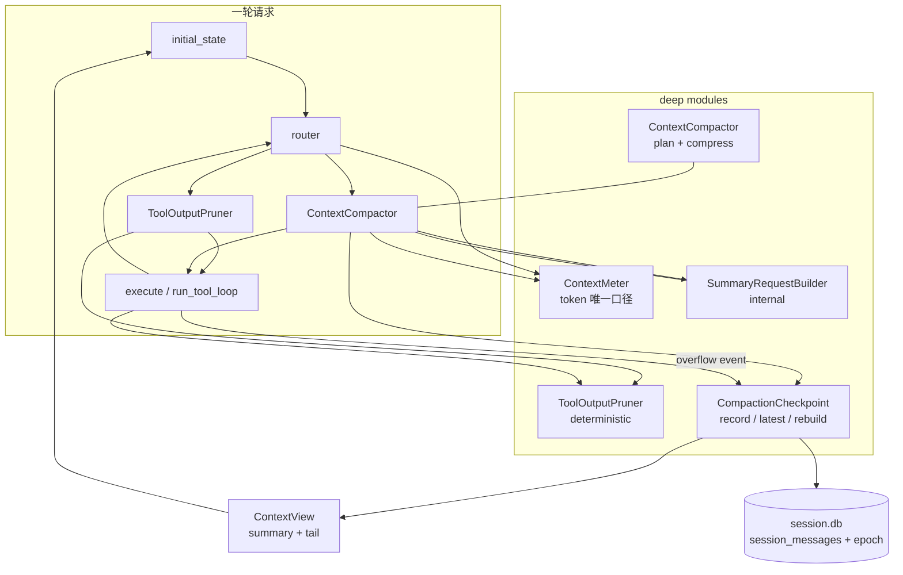
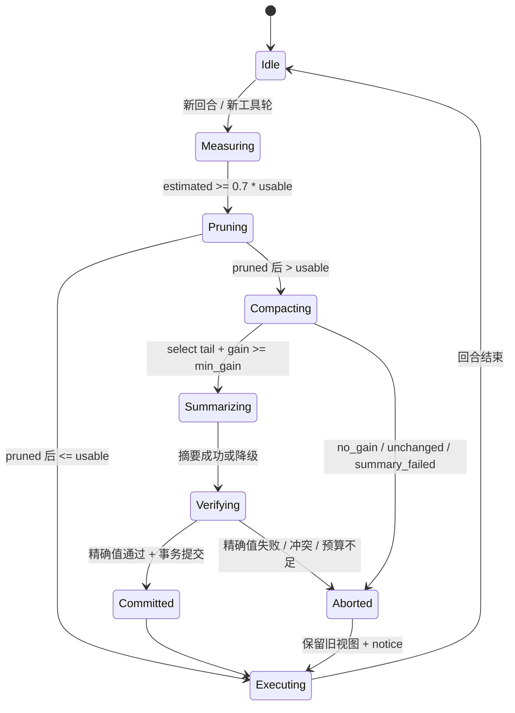

# 上下文压缩 v3 设计报告

> 统一 token 度量、单一压缩入口、单一压缩水位、确定性修剪与可靠溢出恢复。
> 对照源码：`C:\tool\document\opencode-dev`（`packages/opencode/src/session/compaction.ts`、`overflow.ts`）。
> 本文只做设计，不含实现改动。

---

## 0. 摘要

当前后端已经实现了 opencode 风格的“摘要 + tail 回放”，但压缩能力分散在三个入口、两套 token 口径、三处持久化水位里，并且缺少 opencode 的确定性 prune 与持久化溢出恢复。本设计把它们收敛为五个 **deep module**：

| module | 一个 interface | 吸收的复杂度 |
| --- | --- | --- |
| `ContextMeter` | `estimate(view, model) -> TokenEstimate` | tokenizer、校正系数、tool schema、system、图片 |
| `ContextCompactor` | `plan(window, limits)` + `compress(messages, summary, policy)` | tail 选择、分段、摘要、精确值、降级 |
| `CompactionCheckpoint` | `record` / `latest` / `rebuild_view` / `repair` | compaction 行、epoch 快照、模型视角重建 |
| `ToolOutputPruner` | `prune(view, policy) -> PruneResult` | 旧工具输出回收、落盘、幂等 |
| `ContextView` | `summary + tail messages + token estimate` | 调用点不再各自拼历史 |

目标不是“再加一层”，而是 **删除重复路径**：`compress_context`、`split_by_token`、`select_tail`、`should_use_llm_summary` 以及只服务测试的 `compress_messages` 分支，在迁移完成后删除。设计依据是 harness 设计文档 GAP-5 已经声明的“压缩三套实现 → ContextHarness 统一实现”。

---

## 1. 问题回顾

| # | 现状 | 后果 |
| --- | --- | --- |
| 1 | `graph/routers.py` 与 `harness/compression.py` 用 `cognition/compressor.estimate_tokens`（CJK 字符近似）；`context_guard` / `truncate_messages` 用 `token_counter.estimate_tokens`（tokenizer + 1.13 校正） | 阈值口径漂移；system、tool schema、图片未计入 |
| 2 | `CompressionPlan.for_window` 的 `buffer = max(16k, 15% × window)` | 8k/16k 窗口得到 `threshold = keep = 2000`，压缩抖动 |
| 3 | `tail_turns` 默认 0 = 不限轮数；opencode 默认 2，且 ≤0 表示不保留 tail | 语义相反 |
| 4 | 自动 / 手动 / 切换 / 溢出四个入口各传一套 threshold、keep、segment、precision 参数 | 行为漂移，测试分散 |
| 5 | `cognition/compressor.py` 的 `compress_context` / `split_by_token` / `select_tail` / `should_use_llm_summary` 生产未调用 | shallow 代码，误导维护者 |
| 6 | `prune_tool_outputs` 已实现但生产未接线 | 最便宜的省 token 手段闲置 |
| 7 | 溢出压缩只改循环内 `convo`，不落 checkpoint | 下一轮/下一回合重复溢出、重复付摘要成本 |
| 8 | 摘要请求把整段历史（含图片 base64）序列化成一条 user 文本；图内路径不分段 | 最需要摘要时摘要失败，静默退回规则摘要 |
| 9 | 上一轮摘要以 `SystemMessage` 留在 `messages` 中，同时作为 `existing_summary` 传入 | 摘要在估算与摘要请求里出现两次 |
| 10 | summary/tail 同时存在于 graph state、`epoch.snapshot`、`session_messages(compaction)`，并由两个重建器分别解释 | 状态漂移；`tail_start_id` 丢失时回退 `start=0` 会复制全量历史 |

---

## 2. 设计目标与非目标

### 2.1 目标

- **G1 一致性**：router、compactor、guard、budget 对“这段上下文的 token 数”只有一个答案（允许 ±10% 校准误差）。
- **G2 单一入口**：auto / manual / switch / overflow 只调用一个 `ContextCompactor`，策略差异由 `CompactionPolicy` 表达。
- **G3 单一水位**：summary + tail 只由一个 `CompactionCheckpoint` 写入和解释；graph state 只做单轮 cache。
- **G4 确定性优先**：能用 prune 解决的，不调用摘要模型。
- **G5 可靠恢复**：溢出恢复持久化、幂等、可重入；失败可降级但不丢历史、不阻断回答。
- **G6 小窗口正确**：8k/16k 本地模型不再每轮触发压缩。
- **G7 可观测**：每次压缩/修剪都有结构化事件与前后 token 数。

### 2.2 非目标

- 不改变 session.db 作为对话真相源。
- 不重新引入 `MAX_STEPS`、`SUB_AGENT_TIMEOUT` 等已删除字段。
- 不把压缩逻辑放进前端；前端仍只渲染 `compaction` part。
- 不追求与 opencode 字节级一致；只对齐行为不变量与成本边界。

---

## 3. 总体架构



四个 adapter 对同一个 interface：

- **auto**：`graph/nodes/compress.py` → `compress(reason=AUTO)`
- **manual**：`PlatformContext.compact_session` → `compress(reason=MANUAL)`
- **switch**：`harness/switch.py` → `compress(reason=SWITCH)`
- **overflow**：`run_tool_loop` 捕获 `ContextOverflowError` → `compress(reason=OVERFLOW)`

---

## 4. 领域词汇

| 术语 | 定义 |
| --- | --- |
| 上下文视图（ContextView） | 模型本轮可见的历史：`[摘要] + [tail 原文]`，不含当前 user 消息 |
| 压缩水位（Compaction Watermark） | 最新有效 checkpoint 的 `tail_start_id`；水位之前的内容只存在于摘要 |
| tail | 压缩时保留原样的最近若干轮消息，起点由稳定消息 id 标记 |
| 可用窗口（Usable Window） | 模型上下文长度减去输出预留后的 token 预算，压缩阈值以它为准 |
| 保留预算（Preserve Budget） | tail 允许占用的 token 上限 |
| 确定性修剪（Prune） | 不调用模型，把旧工具输出替换为带落盘路径的桩 |
| 降级摘要（Degraded Summary） | 摘要模型失败时用规则抽取的 8 段式摘要 |
| 精确值（Precision Values） | 文件路径、命令、数字、标识符、用户原话等逐字必须保留的内容 |

---

## 5. 模块设计

### 5.1 ContextMeter

**位置**：`backend/cognition/context_meter.py`（新）；底层复用 `cognition/token_counter.py`。
**职责**：给定“消息 + system + tools + 模型”，返回唯一 token 估算；吸收媒体与编码差异。

```python
@dataclass(frozen=True)
class TokenEstimate:
    total: int
    messages: int
    system: int
    tools: int
    media: int
    source: Literal["native", "tiktoken", "heuristic", "usage"]

class ContextMeter:
    def estimate(
        self,
        messages: Sequence[Any],
        *,
        system: str = "",
        tools: Sequence[dict] | None = None,
        model_id: str = "",
    ) -> TokenEstimate: ...

    def observe(self, model_id: str, estimated: int, actual_prompt_tokens: int) -> None:
        """用 Provider 真实 usage 做 EMA 校准（复用 token_counter.update_token_correction）。"""
```

**内部 adapter**

1. `native`：`models/deepseek_tokenizer.count_messages_tokens` / `count_tokens`。
2. `tiktoken`：`cl100k_base × correction`。
3. `heuristic`：`CJK × 1.5 + other / 4`（仅最后兜底）。
4. `usage`：有真实 `prompt_tokens` 时直接采用，并用它校准估算系数。

**关键规则**

- 永远不 `str()` 图片/base64。`content` 为分块列表时：文本块逐块计数；图片块按 `settings.image_token_estimate`（默认 1600）计；未知块忽略不计但记录 `media_unknown=True`。
- `tools` 通过 `estimate_tools` 计入；system prompt 单独计入。
- 提供 `estimate_view(view)` 便捷方法，压缩器与 guard 共用。
- 估算结果可缓存：以 `(model_id, len(messages), first_id, last_id, message_id_hash, tools_hash, system_hash)` 为 key；命中则 O(1)。缓存只用于同一轮内多次 router 判断。

**验收不变量**

- 同一组输入，`ContextMeter.estimate` 与 `token_counter.estimate_tokens_messages` 在无图片时误差 ≤ 5%。
- 带图片消息的估算不随 base64 长度线性增长。
- `estimate.total >= messages + tools + system`。

---

### 5.2 ContextCompactor

**位置**：`backend/cognition/compressor.py` 重写为唯一实现；`backend/harness/compression.py` 保留为薄 facade（只 re-export，不含逻辑）。

**公开 interface（只有两个方法）**

```python
@dataclass(frozen=True)
class CompactionPlan:
    context_window: int
    usable: int                 # 压缩阈值
    preserve_tokens: int        # tail 预算
    tail_turns: int             # 0/负数 = 不保留 tail
    min_gain: int               # 最小收益，防抖动

@dataclass(frozen=True)
class CompactionPolicy:
    reason: Literal["auto", "manual", "switch", "overflow"]
    require_llm: bool = False
    require_precision: bool = False
    allow_fallback: bool = True
    max_segments: int = 4
    summary_model: Any | None = None

@dataclass
class CompressionResult:
    triggered: bool
    summary: str
    tail: list[Any]
    tail_start_id: str | None
    tokens_before: int
    tokens_after: int
    missing_precision: tuple[str, ...]
    used_llm: bool
    degraded: bool
    request_tokens: int
    segments: int
    skipped_reason: str | None

class ContextCompactor:
    def plan(self, *, context_window: int, max_output_tokens: int) -> CompactionPlan: ...
    async def compress(
        self,
        messages: Sequence[Any],
        *,
        existing_summary: str = "",
        policy: CompactionPolicy,
        plan: CompactionPlan | None = None,
    ) -> CompressionResult: ...
```

**策略公式（对齐 opencode `overflow.ts` / `compaction.ts`）**

| 量 | 公式 | 说明 |
| --- | --- | --- |
| `C` | `effective_context_length(model)` | 目录/运行时窗口 |
| `O` | `max_output_tokens` | 目录 limits |
| `O'` | `O` if `0 < O < C` else `min(8192, max(2048, C // 4))` | 防止 Ollama 把 `max_output_tokens` 报成 `C` |
| `R` | `min(20_000, O')` | 输出预留，对齐 `COMPACTION_BUFFER` |
| `U` | `max(2_048, C - R)` | 可用窗口 = 压缩阈值 |
| `P` | `configured or clamp(int(U * 0.25), 2_000, 8_000)` | 保留预算，对齐 `preserveRecentBudget` |
| `tail_turns` | `settings.compaction_tail_turns`，默认 2；`<=0` = 不保留 tail | 修正当前 0 = 不限轮数的反向语义 |
| `min_gain` | `max(1_024, int(U * 0.05))` | 低于此收益不落 checkpoint |
| `S` | `min(12_000, max(4_000, U_summary // 4))` | 摘要分段预算 |

**窗口示例**

| C | O' | R | U | P |
| --- | --- | --- | --- | --- |
| 8,192 | 2,048 | 2,048 | 6,144 | 2,000 |
| 16,384 | 4,096 | 4,096 | 12,288 | 3,072 |
| 32,768 | 8,192 | 8,192 | 24,576 | 6,144 |
| 65,536 | 8,192 | 8,192 | 57,344 | 8,000 |
| 128,000 | 8,192 | 8,192 | 119,808 | 8,000 |

对比当前：8k/16k 的 `threshold = keep = 2000` 被消除；小窗口不再每轮触发。

**`compress()` 内部步骤**

1. **去重视图**：丢弃 input 中以 `[历史摘要]` 开头的合成 `SystemMessage` 与旧 compaction 行；`existing_summary` 只通过 prompt anchor 进入一次。
2. **尾部选择**：`select_tail(messages, P, tail_turns)`。按 user 轮次切分；允许在 assistant 边界切开；禁止 tail 以孤立 tool 消息开头。每轮只估算一次并缓存。
3. **收益判断**：`saved = estimate(messages) - (estimate(tail) + estimate(summary))`；若 `saved < min_gain`，返回 `triggered=False, skipped_reason="no_gain"`。
4. **摘要**：调用内部 `SummaryRequestBuilder`；LLM 失败且 `allow_fallback` → `build_fallback_summary(head)`，标记 `degraded=True`；否则返回 `triggered=False, skipped_reason="summary_failed"`。
5. **精确值**：`enforce_precision` 回填；`require_precision` 时校验 summary+tail 覆盖全部精确值，缺失则抛 `CompressionError`。
6. **结果**：`tail_start_id = tail[0].id`（稳定 id，禁止 index）；`tokens_after` 用 `ContextMeter` 计。
7. **幂等**：若 `tail_start_id` 与最新 checkpoint 相同且 summary 哈希相同 → `triggered=False, skipped_reason="unchanged"`。

**决策（与现有实现不同）**

- `tail_turns` 的 0 语义改为“不保留 tail”，与 opencode 一致；默认从 0 改为 2。迁移期用 `compaction_tail_turns_legacy_zero` 开关保留旧行为一个版本。
- `compaction_buffer` 保留为兼容别名；新键 `compaction_reserved_tokens` 优先。
- 摘要模型解析顺序：显式 `compress_model` > 会话主模型 > simple tier；每次解析失败都降级到规则摘要并记录事件。

---

### 5.3 SummaryRequestBuilder（内部，不是公开 interface）

**位置**：`cognition/compressor.py` 内部私有类。
**职责**：保证“摘要请求本身装得下”，并防止媒体进入摘要文本。

**规则（对齐 opencode `compaction.ts:415-435`）**

1. `head`（待压缩部分）通过 `to_provider_messages` 变成真实模型消息；`strip_media=True`，tool 输出按 2000 字符截断。
2. `tail` 序列化成文本，作为 `<recent-conversation-tail>` 放进摘要 prompt；不重复作为模型消息发送。
3. `previous_summary` 放进 `<previous-summary>`，只出现一次。
4. 用 **压缩模型自己的** usable 窗口判断是否分段；每段预算 `S`；最多 `max_segments` 段。
5. 任一段仍超窗或调用失败：整次压缩降级到确定性摘要；不把半成品摘要写库。
6. 请求估算与实际 `prompt_tokens` 都记录到 `CompressionResult` 与事件。

**为什么不是公开 interface**：调用方不需要知道 head/tail 如何编码；这是 compactor 的实现细节。只有 “摘要请求必须装得下” 是不变量。

---

### 5.4 CompactionCheckpoint

**位置**：`backend/app/session/compaction.py`（新）；吸收 `app/session/projector.py:rebuild_model_messages`、`app/session/history.py:load`、`PlatformContext.persist_compaction`、`resolve_context_binding` 的合并逻辑。

```python
@dataclass(frozen=True)
class Checkpoint:
    session_id: str
    seq: int
    summary: str
    tail_start_id: str | None
    tokens_before: int
    tokens_after: int
    reason: str
    model: str
    idempotency_key: str

@dataclass(frozen=True)
class ContextView:
    summary: str
    messages: list[Any]          # tail 原文，已排除摘要占位
    checkpoint_seq: int | None
    estimate: TokenEstimate

class CompactionCheckpoint:
    def record(self, session_id: str, result: CompressionResult, *, reason: str,
               expected_seq: int | None = None) -> Checkpoint | None: ...
    def latest(self, session_id: str, *, hidden_ids: set[str]) -> Checkpoint | None: ...
    def rebuild_view(self, session_id: str, *, hidden_ids: set[str],
                     baseline: int | None = None) -> ContextView: ...
    def repair(self, session_id: str) -> None:
        """启动/读取时根据最新 compaction 行修复 epoch.snapshot。"""
```

**唯一真相源**

- `session_messages(type='compaction')` 是 checkpoint 的权威记录；`epoch.snapshot` 是查询缓存，可在任意时刻由最新 compaction 行重建。
- `graph state` 的 `context_summary` / `context_tail_start_id` 只在单轮内使用；跨轮一律从 DB 重建。
- `history.load` 删除或改为内部调用 `rebuild_view`，不再保留第二套过滤规则。
- `tail_start_id` 找不到时 **不再回退 `start=0`**：按 `tail_start_seq`（新字段）定位；两者都缺失则视为 checkpoint 损坏，`repair` 重建或忽略该 checkpoint 并告警。禁止把全量历史接在摘要后面。

**写入事务**

```text
BEGIN IMMEDIATE
  1. 校验 expected_seq == latest_seq（或只允许新增消息，不允许 hidden/baseline 变化）
  2. INSERT session_messages(type='compaction', data={summary, tail_start_id, tail_start_seq, ...,
                                                       idempotency_key})
  3. UPDATE session_context_epoch SET baseline_seq=?, snapshot=?
  4. UPDATE sessions SET time_compacted=?, last_prompt_tokens=?
COMMIT
```

失败回滚，旧 checkpoint 保持有效；调用方收到 `None`，本轮继续用旧视图，不阻断回答。

**并发**

- 复用 `SessionService` 的每会话写串行锁；摘要生成在锁外完成，提交时才取锁。
- 提交时若发现 `hidden_ids` / `baseline_seq` / `latest_seq` 与快照不一致：重算 tail 并重试 1 次；仍冲突则放弃本次 checkpoint（记录 `compaction_skipped=conflict`）。
- 撤销到 checkpoint 之前时，由同一个 module 同时隐藏 compaction 行并回退 epoch；不允许调用方分别操作。

---

### 5.5 ToolOutputPruner

**位置**：`backend/cognition/tool_output.py`（现有 `prune_tool_outputs` 提升为正式 module，新增持久化记录）。

```python
@dataclass(frozen=True)
class PrunePolicy:
    protect_tokens: int = 40_000
    minimum_tokens: int = 20_000
    tail_tool_rounds: int = 2
    protected_tools: frozenset[str] = frozenset({"skill"})

@dataclass(frozen=True)
class PruneResult:
    messages: list[dict]
    pruned_tokens: int
    pruned_count: int
    saved_paths: dict[str, str]      # tool_call_id -> 落盘路径

class ToolOutputPruner:
    def prune(self, messages: list[dict], *, policy: PrunePolicy) -> PruneResult: ...
```

**接线点**

1. **请求装配前**：`run_tool_loop` 每轮调用前、以及 `execute` 组装 history 后调用。仅当 meter 估算超过 `U * 0.7` 时执行，避免每轮全量扫描。
2. **压缩前**：compactor 对 head 先 prune，再判断是否需要 LLM 摘要。
3. **溢出时**：先 prune，仍超窗才做语义压缩。

**持久化与幂等**

- 不修改 `session_messages.data.content`（原文保留）；写 `data.prune = {path, tokens, at}`。
- `rebuild_view` 读到 `data.prune` 时用桩替换 content；桩里带落盘路径，模型可 `read_file` 续读。
- 重复 prune 遇到已有 `data.prune` 或桩文本 → 跳过；`pruned_tokens < minimum_tokens` → 原样返回。
- 落盘失败 → 不替换（保留原文），记录 `prune_persist_failed`；宁可多花 token，不丢信息。

**默认值**

`compaction_prune=true`，`compaction_prune_protect_tokens=40000`，`compaction_prune_minimum_tokens=20000`，`compaction_prune_protected_tools=["skill"]`。与 opencode `compaction.ts:36-39` 对齐。

---

### 5.6 ContextView 与调用点适配

```python
class ContextView:
    summary: str
    messages: list[Any]     # 已应用 prune 与 tail replay，不含摘要占位
    checkpoint_seq: int | None
    estimate: TokenEstimate
```

- `PlatformContext.rebuild_history` → `CompactionCheckpoint.rebuild_view`。
- `initial_state(history_messages=view.messages, context_summary=view.summary)`；graph state 中不再保留 `context_tail_start_id` 的跨轮权威性。
- `execute._conversation_history` 直接消费 `state.messages`；删除“先跳过 `[历史摘要]` 再插入摘要”的重复逻辑。
- `session_messages`（前端回放）仍从 DB 读取；压缩卡由 checkpoint 行生成，不再依赖 graph state 的 `compaction_event`。

---

## 6. 状态与生命周期



**触发条件**

- 自动：`compaction_auto && !context_compressed && estimated >= plan.usable && saved >= min_gain`。
- 每个回合最多自动压缩 1 次（沿用 `context_compressed`）；每会话 LLM 摘要调用上限 `compaction_max_llm_calls`（默认 10）。
- 压缩后冷却：下一回合若 `estimated < usable * 1.05` 且没有新增 user 轮，不再次触发。

---

## 7. 可靠性设计

### 7.1 不变量（测试必须钉住）

| ID | 不变量 |
| --- | --- |
| I1 | 幂等：相同视图重复压缩返回 `triggered=False`，不产生新 checkpoint |
| I2 | 单调：新 checkpoint 的 `tail_start_seq` 严格大于旧 checkpoint |
| I3 | 原子：compaction 行与 epoch 快照同事务提交；失败回滚 |
| I4 | 非空：永不写入空摘要；LLM 失败走确定性摘要或放弃 |
| I5 | 精确：`require_precision=True` 时路径/命令/数字/用户原话 0 丢失 |
| I6 | 有界：摘要请求 token ≤ 压缩模型 usable；超限先分段，再降级 |
| I7 | 不重复：previous summary 在摘要请求中只出现一次；旧 compaction 行不参与再摘要 |
| I8 | 稳定：tail 起点用消息 id/seq，禁止 index / model+index |
| I9 | 不丢历史：prune 原文落盘；DB 原文不改；checkpoint 不物理删除 |
| I10 | 可恢复：进程在提交前崩溃，重启后 `repair` 从 compaction 行修复 epoch |
| I11 | 不阻断：任何压缩失败都返回可继续的旧视图，并推 notice |
| I12 | 预算：每次摘要调用计入 `BudgetLedger`；超预算降级，不重试烧钱 |
| I13 | 小窗口：`plan.usable > plan.preserve_tokens` 恒成立（8k 起） |

### 7.2 失败模式与处理

| 失败 | 检测 | 处理 | 用户可见 |
| --- | --- | --- | --- |
| 摘要模型 429/5xx/超时 | `retry_async` 重试后仍失败 | 降级确定性摘要（`allow_fallback`） | `degraded=true` 事件 |
| 摘要请求自身超窗 | 请求估算 > 压缩模型 usable | 分段；超过 `max_segments` 降级 | 时间线 notice |
| 摘要为空 | `summary.strip() == ""` | 降级；仍为空则放弃 checkpoint | 无正文影响 |
| 精确值缺失 | `enforce_precision` 后仍缺 | switch 路径回滚；其他路径回填后继续 | switch 返回明确错误 |
| DB 锁 | SQLite `busy` | 50ms × 3 退避 | 无（本轮用旧视图） |
| 提交冲突（撤销/并发） | baseline/hidden/latest 变化 | 重算 tail 重试 1 次；仍冲突放弃 | `compaction_skipped=conflict` |
| 进程崩溃 | 启动 `repair` | 用最新 compaction 行修 epoch | 无 |
| 落盘失败（prune） | `OSError` | 不替换内容 | `prune_persist_failed` |
| 预算耗尽 | `BudgetExceeded` | 跳过 LLM 摘要，用规则摘要 | `budget_exceeded` 已有事件 |
| 小窗口 | `C < 4k` | 关闭自动压缩，只用 prune + guard | `compaction_disabled_small_window` |

### 7.3 可观测性

结构化事件（SSE 与日志同源）：

- `context_pruned`：`tokens_before/after`、`count`、`min_gain`、`duration_ms`
- `compaction_started`：`reason`、`usable`、`preserve`、`estimated`
- `compaction_completed`：`reason`、`tokens_before/after`、`used_llm`、`degraded`、`segments`、`request_tokens`、`tail_start_id`
- `compaction_skipped`：`reason`（`no_gain` / `unchanged` / `conflict` / `small_window` / `budget`）
- `compaction_failed`：`stage`、`error_type`、`retryable`
- `context_overflow_recovered`：`tokens_before/after`、`persisted=true`

指标：压缩比、LLM 摘要次数/会话、降级率、prune 节省 token、溢出次数、压缩耗时 P50/P95。

---

## 8. 模型效率收益

| 手段 | 预期效果 | 依据 |
| --- | --- | --- |
| prune 先于摘要 | 多数工具密集回合不触发 LLM 摘要；单次请求最多回收约 40k 保护线以上的旧输出 | opencode `PRUNE_PROTECT=40k` |
| 摘要去重 | 每次压缩少传一份 previous summary；不再把摘要当历史再摘要 | I7 |
| 有界摘要请求 | 减少“摘要调用溢出 → 规则兜底”的静默质量损失 | I6 |
| 小窗口公式 | 8k/16k 从每轮触发改为按 6k/12k 触发 | §5.2 |
| 真实 usage 校准 | 阈值不再系统性偏早/偏晚；减少 overflow 重试 | ContextMeter `observe` |
| 持久化溢出恢复 | 一次 overflow 只付一次摘要成本 | §5.4 / §7 |
| 单一口径 | 不再出现 router 与 guard 对同一上下文判断相反 | §5.1 |

不承诺具体百分比；上线后用 `compaction_completed` 与 `context_pruned` 事件对比基线。

---

## 9. 迁移计划

每一步都可独立上线、可回滚。

| 阶段 | 内容 | 开关 | 回滚 |
| --- | --- | --- | --- |
| P0 | 新增 `ContextMeter`，router / guard / budget 接线；保留旧估算 | `CONTEXT_METER_V2` | 关开关回旧函数 |
| P1 | `ContextCompactor.plan/compress` 落地；四个 adapter 切过去；旧函数保留 deprecated | `CONTEXT_COMPACTOR_V3` | 关开关回 `compress_messages` |
| P2 | `CompactionCheckpoint` + `ContextView`；删除 `resolve_context_binding` 特判；`history.load` 收敛 | `CONTEXT_CHECKPOINT_V3` | 关开关回 `rebuild_model_messages` |
| P3 | `ToolOutputPruner` 接线 + 持久化 prune 元数据 | `CONTEXT_PRUNE_V2` | 关开关停止 prune |
| P4 | 溢出恢复持久化 + 摘要请求分段/去媒体 | `CONTEXT_OVERFLOW_V2` | 关开关回临时压缩 |
| P5 | 删除 `compress_context` / `split_by_token` / `select_tail` / `should_use_llm_summary` 与对应旧测试；更新 AGENTS / 设计文档 | — | 由前四步保证 |

**兼容性**

- `harness/compression.py` 在 P5 前保持 re-export，旧 import 不破。
- `compaction_buffer` 保留；新键 `compaction_reserved_tokens` 优先。
- `compaction_keep_tokens` 保留为显式 `P` 覆盖；未设置时按公式计算。
- 新增配置必须同步 `backend/config.example.json` 与 `backend/tests/unit/test_config_example.py`。
- 新增 DB 字段只做 additive：`session_context_epoch.snapshot.tail_start_seq`（JSON 内，无需 DDL）、`sessions.last_prompt_tokens`（`_ensure_column`）。
- `tail_turns` 默认 0 → 2 是行为变更；`compaction_tail_turns_legacy_zero=true` 可回旧语义一个版本。

---

## 10. 测试策略

### 10.1 单元

| ID | 用例 |
| --- | --- |
| UT-METER-01 | CJK/ASCII/代码/中英混排估算与 tokenizer 误差 ≤ 5% |
| UT-METER-02 | 带 base64 图片的估算不随 data URL 长度增长 |
| UT-METER-03 | tool schema 与 system prompt 计入 total |
| UT-METER-04 | 真实 usage `observe` 后系数单调收敛且钳制 |
| UT-PLAN-01 | 8192/16384/32768/65536/128000 的 `U/P` 表与设计一致 |
| UT-PLAN-02 | `O >= C`（Ollama 异常）时走 `O'` 兜底 |
| UT-COMPACT-01 | `tail_turns=2` 保留最近两轮；`0` 不保留 tail |
| UT-COMPACT-02 | tail 不以孤立 tool 开头；不切断 tool_calls 对 |
| UT-COMPACT-03 | `saved < min_gain` → `triggered=False` |
| UT-COMPACT-04 | 重复压缩同视图 → 幂等、无新 checkpoint |
| UT-COMPACT-05 | previous summary 只出现一次 |
| UT-COMPACT-06 | 摘要请求超窗 → 分段；超段数 → 降级 |
| UT-COMPACT-07 | 图片 base64 不出现在摘要 prompt |
| UT-COMPACT-08 | 精确值 0 丢失；`require_precision` 失败抛错 |
| UT-PRUNE-01 | protect/minimum 阈值生效 |
| UT-PRUNE-02 | skill 输出受保护 |
| UT-PRUNE-03 | 原文落盘、stub 带路径、重复 prune 幂等 |
| UT-PRUNE-04 | 落盘失败不替换内容 |
| UT-CKPT-01 | record 原子：行 + epoch 同事务 |
| UT-CKPT-02 | 冲突（撤销/并发）重试后放弃 |
| UT-CKPT-03 | `tail_start_id` 缺失不复制全量历史 |
| UT-CKPT-04 | `repair` 从 compaction 行修复 epoch |
| UT-CKPT-05 | 撤销到 checkpoint 之前，视图与绑定同时回退 |

### 10.2 契约 / 集成

| ID | 用例 |
| --- | --- |
| CT-CTX-01 | `CompressionResult` / `ContextView` 字段与事件 schema 稳定 |
| IT-CTX-01 | auto 压缩 → 下一轮 rebuild = 一份摘要 + tail，无重复摘要 |
| IT-CTX-02 | manual compact 与 auto 产出一致语义 |
| IT-CTX-03 | 切换小窗口模型：阈值/保留预算随目标窗口绑定 |
| IT-CTX-04 | 工具循环中 overflow：落 1 个 checkpoint，下一轮不再溢出 |
| IT-CTX-05 | 带图回合：压缩成功且摘要 prompt 不含 base64 |
| IT-CTX-06 | 并发：手动 compact 与回合写交错，无重复/丢失 checkpoint |
| IT-CTX-07 | 进程崩溃模拟：epoch 缺失，读取时 repair |
| IT-CTX-08 | 撤销后再压缩：水位单调，不复活旧摘要 |
| IT-CTX-09 | prune 后模型仍可通过 `read_file` 读取原文 |

### 10.3 性质测试（hypothesis）

- 随机消息序列：`rebuild_view(compress(x))` 的 token ≤ `compress` 前；无孤儿 tool；tail id 稳定。
- 连续压缩 1..N 次：checkpoint 水位单调，最终收敛（幂等）。
- 任意窗口 2k..256k：`U > P >= 2k`，`U <= C`。

### 10.4 性能

- 500 条消息、20 个工具 schema：`plan + select_tail + estimate` P95 < 50ms（不含 LLM）。
- prune 命中时：P95 < 100ms（含落盘 1 次）。
- 现有 `pytest` 全量 + Harness 覆盖率门槛 90% 不得下降。

---

## 11. 验收标准

1. **计划正确**：`[8192, 16384, 32768, 65536, 128000]` 的 `U/P` 与 §5.2 表一致；`U > P`。
2. **不再抖动**：8k/16k 窗口下，连续 5 个短回合不触发 LLM 摘要；达到 `U` 后只触发一次。
3. **单一水位**：任意回合 `rebuild_view` 只产生一份摘要；`previous summary` 在摘要请求中出现一次。
4. **可靠恢复**：模拟 overflow 后，DB 中恰有 1 条新 compaction；下一回合估算低于 `U`。
5. **确定性优先**：在工具输出密集语料上，`context_pruned` 先于 `compaction_started` 的比例可观测；prune 节省 token > 0 时不再调用 LLM 摘要。
6. **无回归**：`pytest` 全量通过；Harness 覆盖率 ≥ 90%；前端 `npm test` / `npm run build` 通过。
7. **可回滚**：任一阶段开关关闭后回到当前行为；旧 checkpoint 仍可读。
8. **可观测**：所有压缩/修剪事件带 `session_id`、`turn_id`、`reason`、前后 token、耗时。

---

## 12. 风险与开放问题

| 风险 | 缓解 |
| --- | --- |
| `tail_turns` 默认变更影响既有会话行为 | 开关保留旧语义一个版本；上线后对比 `tokens_after` 分布 |
| 分段摘要增加延迟与调用次数 | 最多 4 段；优先 prune；仅在请求超窗时启用 |
| Ollama `max_output_tokens` 不可信 | `O'` 规范化 + 运行时窗口探测 |
| 真实 usage 不稳定（流式/部分 Provider） | usage 缺失时用估算；EMA 钳制 |
| prune 元数据与撤销/分叉交互 | prune 只改视图，不改原文；分叉复制原文，重建时按新会话重新 prune |
| 迁移期双写不一致 | 以 compaction 行为权威；epoch 可 `repair`；P5 前保留旧读路径 |
| 摘要质量下降（降级路径） | 精确值回填 + `degraded` 指标；真实模型 E2E 验收 |

**开放问题**

1. `compaction_buffer` 是否直接废弃，还是永久保留为 `compaction_reserved_tokens` 的别名？
2. 图片 token 估算是否需要按 provider/model 配置（当前统一 1600）？
3. prune 是否应每轮执行，还是只在 `estimated >= 0.7 * U` 时执行？本设计选后者，需用生产数据验证。
4. 是否允许 auto compaction 在工具循环中途触发？本设计允许一次，但要求先 prune；若数据表明中途压缩影响工具配对，则改为只在本轮结束后触发。

---

## 附录 A：与 opencode 的对应关系

| opencode | 本设计 |
| --- | --- |
| `overflow.ts:usable` | `ContextCompactor.plan` 的 `U/R` |
| `compaction.ts:preserveRecentBudget` | `P` |
| `compaction.ts:select/splitTurn` | `ContextCompactor.select_tail` |
| `compaction.ts:prune` | `ToolOutputPruner` |
| `compaction.ts:process` 的 head/tail 装配 | `SummaryRequestBuilder` |
| `compaction.ts:412-419` 隐藏旧 compaction | `rebuild_view` 丢弃旧 compaction 行；`summary` 只经 anchor |
| `message-v2.ts:serialize` 的 `stripMedia/toolOutputMaxChars` | `SummaryRequestBuilder` 的媒体剥离与 2000 字符截断 |
| `overflow` 后 replay 最后 user | overflow 恢复保留当前 user，不重复注入 |

## 附录 B：建议新增配置

```jsonc
{
  "compaction_auto": true,
  "compaction_keep_tokens": 0,          // 0 = 按公式；>0 = 显式覆盖 P
  "compaction_reserved_tokens": 0,      // 0 = 按公式；>0 = 显式覆盖 R
  "compaction_buffer": "15%",           // 兼容旧键
  "compaction_tail_turns": 2,
  "compaction_tail_turns_legacy_zero": false,
  "compaction_max_llm_calls": 10,
  "compaction_min_gain_tokens": 0,      // 0 = 按公式
  "compaction_prune": true,
  "compaction_prune_protect_tokens": 40000,
  "compaction_prune_minimum_tokens": 20000,
  "compaction_prune_protected_tools": ["skill"],
  "image_token_estimate": 1600
}
```

---

## 附录 C：实现状态（2026-11-04）

**已落地**

- `cognition/context_meter.py`：`ContextMeter` / `TokenEstimate`；媒体按块固定成本，不数 base64；router 与压缩估算已切换。
- `CompressionPlan`：`reserved = min(20k, 归一化输出)`、`usable`、`preserve = clamp(25% × usable, 2k, 8k)`、`min_gain`；8k/16k 窗口不再落 2k 阈值。
- `tail_turns`：默认 2；`<=0` 表示不保留 tail（对齐 opencode）。
- 摘要请求：过滤旧摘要占位、`serialize_messages` 剥离媒体、按压缩模型窗口分段；图内路径也启用分段。
- `min_gain`：低于收益不落 checkpoint。
- 确定性 prune：`run_tool_loop` 在请求装配前按 `0.7 × usable` 触发，原文落盘、上下文替换为桩（当前为请求内生效，DB 原文不改）。
- overflow：压缩结果通过 `on_compaction` 回调写回图状态，`PlatformContext` 持久化为 compaction checkpoint。
- `app/session/compaction.py`：`CompactionCheckpoint.record/latest/rebuild_view/repair`；`repository.record_compaction` 在同一事务内写 compaction 行 + epoch 快照。
- `ContextCompactor` 公开 facade：`plan` + `compress`；manual 与 overflow 已切过去，switch 仍复用 `compress_messages` 的专门策略。
- prune 元数据持久化：`session_messages.data.prune` 记录落盘路径与 token；`projector` 重建时输出桩，`upsert_message` 重新投影时保留 prune 元数据，原文永不改写。
- `CompactionCheckpoint.repair` 已接入 `ensure_conversation`（每回合按可见 checkpoint 修复 epoch，撤销隐藏的 checkpoint 不会复活）。
- P5 清理完成：删除 `compress_context` / `split_by_token` / `select_tail` / `should_use_llm_summary` / `contains_precision_keyword` 及其导出与旧测试；`cognition/compressor.py` 只保留估算、序列化、精确值、兜底摘要。
- 测试：`tests/unit/test_context_meter.py`、`tests/unit/test_compaction_checkpoint.py`、overflow/prune 用例；后端全量 `pytest` 通过。

**仍可继续优化（不影响当前正确性）**

- `switch` 可进一步改为只依赖 `ContextCompactor`，与 manual/overflow 完全同路。
- 新配置已加入 `config.example.json`，但前端「设置」页尚未暴露 prune / min_gain 开关。
- 覆盖率门槛未在本机验证（venv 未安装 `pytest-cov`）。
