# Harness 架构重设计（v2）

> 版本：1.0（设计稿）｜ 日期：2026-10-24
> 输入依据：`docs/agent.md`、`docs/agent-1.md`、`docs/agent-2.md`、`docs/agent-3.md`、`docs/agent-4.md`
> 参考范式：Claude Code / opencode / AnyToolCall / ollama-tools 一类「Agent Loop + 能力探测 + 原生/文本双路径 + 上下文分层」Harness 设计
> 现状代码：`backend/harness/*`、`backend/graph/*`、`backend/models/*`、`backend/execution/*`、`backend/app/session/*`
>
> 本文只做设计与测试方案，不包含代码改动。实现按 §12 迁移计划分批落地。

---

## 0. 一页结论

1. **Harness 必须是「一个入口 + 一条主循环 + 三个横切面」**：
   - 一个入口：`TurnHarness.run()`，取代当前散落在 `app/api/compat.py`、`app/deps.py`、`graph/main_graph.py` 的编排职责。
   - 一条主循环：`AgentLoop`（Step = 模型调用 → 工具调用 → 结果回灌），循环不感知任何厂商格式。
   - 三个横切面：`Tool Harness`（原生/文本双路径）、`Context Harness`（原文/摘要/模型绑定三层）、`Governance Harness`（预算/权限/Hook/审计）。
2. **模型能力不可信任**：能力表未命中一律走文本回退；原生路径也必须做格式归一化、流式前置抑制与参数错误回灌。
3. **上下文只换引擎，不换记忆**：模型切换必须走「门禁 → 备份 → 分段摘要 → 精确值探针 → 原子提交/回滚」，消息 ID 用稳定哈希，不用 index / model+index。
4. **成本按图控制**：压缩走 simple tier + 三道门禁 + 精确值回填；扇出走 medium tier + 预算/次数/任务特征三道门禁，默认关闭；单轮预算单调递减，切换模型不清零。
5. **测试从图派生**：每张业务图的节点、边、失败分支、数据存储读写都映射到测试用例；先做 **节点覆盖 + 边覆盖 + 不变量覆盖**，再做端到端黄金集。
6. **不静默降级**：能力未知、模型选择失败、工具不可用、预算超限、切换失败，都必须产生可观测事件并给出明确结果，绝不“悄悄换一个默认值继续跑”。

---

## 1. 目标、范围与非目标

### 1.1 目标

| 编号 | 目标 | 可验证结果 |
| --- | --- | --- |
| G1 | 跨模型可继续同一会话 | 模型 A 产生的工具调用历史，切到模型 B 后仍可被理解并继续 |
| G2 | 不支持原生 tool_calls 的模型可用工具 | 文本回退路径端到端完成「读文件 → 修改 → 回答」 |
| G3 | 切换模型不丢事实 | 路径、ID、端口、金额、用户原话在切换后仍可召回 |
| G4 | 上下文可控 | 超阈值压缩后仍保留精确值；长会话不超窗 |
| G5 | 成本可控 | 压缩/扇出均有门禁；单轮预算超限即熔断 |
| G6 | 安全可控 | 越权工具、越界路径、危险命令、提示词注入全部有拦截点 |
| G7 | 可观测、可回归 | 每次模型调用/工具调用/切换/压缩都有事件与测试锚点 |
| G8 | 编排可测 | 关键路径与失败路径都能用 FakeModel/FakeTool 在秒级复现 |

### 1.2 范围

- 单轮（Turn）编排：输入过滤 → 计划 → 检索 → 工具循环 → 综合 → 持久化。
- 模型适配：原生工具调用、文本回退、流式增量解析、历史归一化。
- 上下文：工作记忆、摘要、tail 回放、压缩、模型切换迁移。
- 工具：注册表、schema、调度、权限审批、Hook、结果有界化。
- 多 Agent：`task` 委派、并行扇出、预算门禁、上下文隔离。
- 观测：Trace、Token/成本、事件流、审计。

### 1.3 非目标

- 不引入 GraphRAG（agent-2 §13.7 明确不建议）。
- 不把知识图谱、微服务拆分、多租户计费放进本期。
- 不重写 `app/session` 存储层与前端；只定义 Harness 与它们的契约。
- 不追求「所有模型都能完美工具调用」；目标是**不可用时也能优雅回退**。

---

## 2. 现状盘点与差距（设计依据）

### 2.1 已具备的能力

| 能力 | 现有落点 | 结论 |
| --- | --- | --- |
| 原生/文本双路径 | `backend/harness/{capabilities,adapter,delimiters,tool_adapter}.py` | 骨架完整，可复用 |
| 流式增量解析 | `backend/harness/streaming.py` | 单测覆盖好，但主循环未使用 |
| 历史归一化 | `backend/harness/history.py` | 已覆盖 orphan tool / fallback 文本化 |
| 工具 Hook | `backend/harness/hooks.py` | contextvar 注入，可复用 |
| 工具循环 | `graph/nodes/base.py:run_tool_loop` | 已接 ToolAdapter.complete |
| 模型切换 | `app/deps.py:PlatformContext.switch_model` | 门禁/备份/探针/审计已具备 |
| 压缩 | `cognition/compressor.py` + `graph/nodes/compress.py` | 9 段式 + 精确值回填已具备 |
| RAG 门禁 | `graph/nodes/rag.py` + `graph/routers.py` | grade + rewrite + 次数上限已具备 |
| 并行扇出 | `graph/routers.py:should_plan_parallel` + `parallel_worker` | 三门禁 + 默认关闭已具备 |

### 2.2 必须解决的差距

| 编号 | 差距 | 影响 | 设计对策 |
| --- | --- | --- | --- |
| GAP-1 | 编排职责分散在 `compat.py` / `deps.py` / 图节点 | 难以做统一预算、取消、事件、测试 | 新增 `TurnHarness` 单一入口（§3.2） |
| GAP-2 | 主循环只调用 `ToolAdapter.complete`，流式解析器未接入 | 回退模型工具调用延迟到整段结束；前端看到“卡住” | 主循环支持 `stream` 事件，定界符闭合即执行（§6.2） |
| GAP-3 | 工具调用 ID 不稳定：流式路径用 `harness-{id(call):x}`，非流式路径用 `harness-{uuid4}` | 跨进程/重放不稳定，事件去重与持久化困难 | 统一确定性 ID（§5.4） |
| GAP-4 | `finish_reason` 未被主循环消费 | `length` / `content-filter` 被当正常答案 | `StepOutcome` 显式建模（§5.3） |
| GAP-5 | 压缩有三处实现：图节点、切换迁移、手动 compact | 阈值/模板/尾巴语义漂移 | `ContextHarness` 单一实现，三处复用（§7） |
| GAP-6 | 工具 schema 每轮重建、无工具数上限 | 工具多时选择准确率下降、token 浪费 | `ToolSchemaCache` + 15 个上限 + scope 分组（§6.4） |
| GAP-7 | 工具输出未统一有界化 | 大文件读取可能撑爆上下文 | `ResultPolicy` + 落盘续读（§6.5） |
| GAP-8 | 预算只在扇出门禁检查，主循环无单轮上限 | 成本攻击/死循环可烧穿预算 | `BudgetLedger` 单调扣减 + 熔断（§8） |
| GAP-9 | 能力表只判 `tool_use`，无版本/TTL | 目录刷新后判断过期；vision/reasoning 未参与 | `ModelProfile` + 目录刷新 + 人工覆盖（§5.2） |
| GAP-10 | 错误类型未统一 | 前端重试策略、日志归因不一致 | `HarnessError` 分类（§5.6） |
| GAP-11 | 切换模型缺“风格差异 vs 数据丢失”自动判定 | 误报回滚或漏报 | 三层校验 + 探针（§9） |
| GAP-12 | 缺少“从图派生测试”的显式映射 | 覆盖率不可解释 | 本文 §11 追溯矩阵 |

> 结论：**不是推倒重来，而是把现有能力收敛到一个可测试的 Harness 内核**。现有单测（`tests/unit/test_harness_*.py` 等）保留并作为回归基线。

---

## 3. Harness 总体架构

### 3.1 分层图（业务架构图）

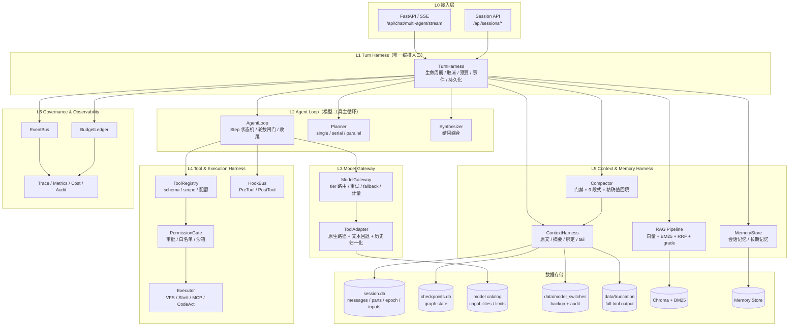

### 3.2 组件职责

| 组件 | 单一职责 | 不做什么 |
| --- | --- | --- |
| `TurnHarness` | 一轮请求的生命周期、取消、预算、事件、最终持久化 | 不解析模型格式、不直接执行工具 |
| `AgentLoop` | Step 状态机：模型 → 工具 → 回灌 → 再模型 | 不知道模型是 OpenAI 还是 Ollama |
| `Planner` | 三档计划：单任务 / 串行 / 并行；产出结构化任务 | 不执行任务 |
| `Synthesizer` | 多子任务结果综合；空结果兜底 | 不重新检索 |
| `ModelGateway` | tier 选择、请求模型注入、重试、降级、计量 | 不做工具协议适配 |
| `ToolAdapter` | 能力探测、原生/文本双路径、流式解析、历史归一化 | 不执行工具 |
| `ToolRegistry` | 工具 schema、scope、审批标记、配额 | 不决定何时调用 |
| `PermissionGate` | 工作区/会话目录/外部路径分类、审批、拒绝 | 不做业务判断 |
| `Executor` | VFS、Shell、MCP、CodeAct 的真实执行 | 不感知模型 |
| `ContextHarness` | 模型视角上下文装配、压缩、tail 回放、切换迁移 | 不改原文日志 |
| `BudgetLedger` | 会话/单轮 token 与成本扣减、熔断 | 不负责定价（读 catalog） |
| `EventBus` | 统一事件信封：turn / step / tool / agent / error | 不阻塞主流程 |
| `Observability` | Trace、指标、成本、审计 | 不参与决策 |

### 3.3 目录落位（目标结构，兼容现有路径）

```text
backend/harness/
├── kernel.py            # TurnHarness / TurnContext / TurnResult
├── loop.py              # AgentLoop / StepOutcome / LoopPolicy
├── capabilities.py      # ModelProfile / CapabilityTable（保留并扩展）
├── adapter.py           # 原生/回退统一输出（保留）
├── delimiters.py        # 定界符协议（保留）
├── history.py           # 历史归一化（保留）
├── streaming.py         # 流式解析（保留）
├── tool_adapter.py      # ToolAdapter（扩展 stream 接入）
├── hooks.py             # HookBus（保留）
├── tools/
│   ├── schema.py        # ToolSchemaCache / 工具数上限 / scope
│   ├── dispatch.py      # 参数修复 + 调度 + 错误分类
│   └── result.py        # ResultPolicy / 截断落盘 / 续读提示
├── context/
│   ├── assembler.py     # 三层上下文装配
│   ├── compactor.py     # 压缩门禁 + 摘要 + 精确值回填
│   └── binding.py       # ContextBinding / tail 起点
├── switch.py            # 切换状态机（从 deps 抽出）
├── budget.py            # BudgetLedger
├── events.py            # Event 信封 / EventBus
└── errors.py            # HarnessError 体系
```

> 现有 `backend/harness/*.py` 文件不删除，先把新内核做成**门面**，逐步把职责迁入；旧测试继续跑，防止回归。

---

## 4. 核心业务图

> 约定：图中节点编号 `B*`、边编号 `E*`，与 §11 测试追溯矩阵一一对应。

### 4.1 BF-01 单轮请求主流程

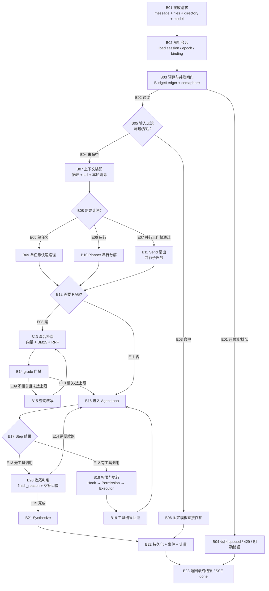

**关键业务规则**

| 规则 | 说明 |
| --- | --- |
| R1 | 寒暄/探活不调用任何模型（固定模板），节省首 token 延迟 |
| R2 | 单任务快速路径不调用 Planner，避免过度委派 |
| R3 | 并行必须同时满足：`plan_tier=parallel` + ≥2 个 agent 任务 + 扇出次数未超 + 剩余预算充足；默认关闭 |
| R4 | RAG 每轮最多检索 `1 + MAX_REWRITE(2)` 次，避免检索死循环 |
| R5 | 工具循环有硬轮数上限（默认 8），到限后必须做一次「不带工具」的收尾调用 |
| R6 | 任何路径都必须产出非空最终文本；空答用工具轨迹或占位文案兜底 |
| R7 | 一轮只允许一个写入者（session write lock），避免并发写坏 seq |

### 4.2 BF-02 工具调用决策（原生 vs 文本回退）

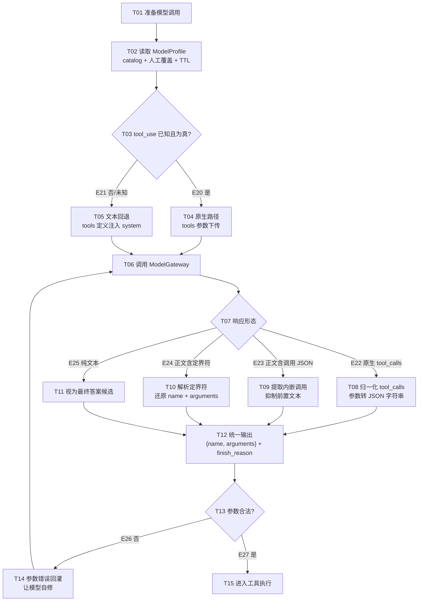

**设计要点**

- **能力探测保守**：未知模型 → 回退，不允许“猜它可能支持”。
- **两条路径统一出口**：Loop 只看到 `ToolCall(id, name, arguments)`，不出现 `tool_use` / `function_call` / 定界符。
- **流式闭合即执行**：回退路径在参数定界符闭合时立刻产出 `ToolCallReady`，不等整段响应结束。
- **错误可恢复**：非法 JSON 不作为异常抛出，而是作为 `role=tool`（原生）或文本结果（回退）回灌，让模型自行修正。
- **历史兼容**：发给目标模型前，旧格式必须归一化或文本化；连续同 role 合并；孤儿 tool 消息降级为文本。

### 4.3 BF-03 模型切换（门禁 → 迁移 → 校验）

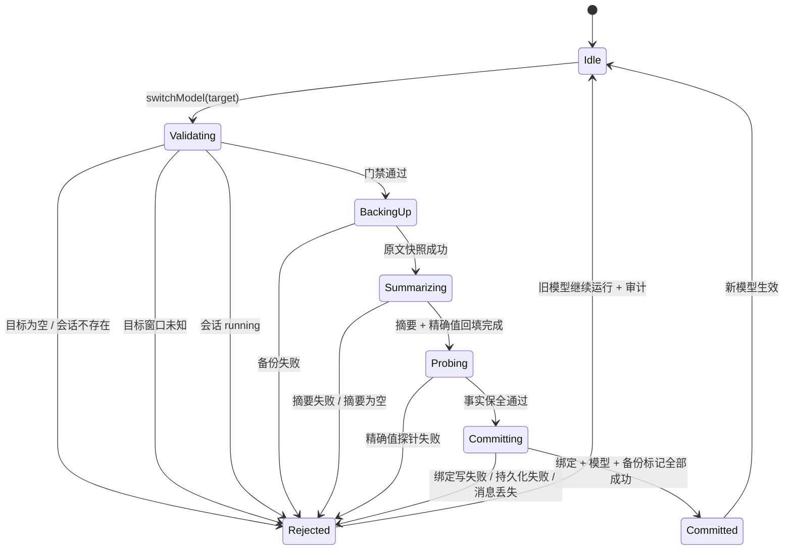

**切换不变量**

| 编号 | 不变量 |
| --- | --- |
| I-SW1 | 切换前必须有原文快照；备份失败即拒绝切换 |
| I-SW2 | 目标模型 `context_length` 未知时拒绝切换 |
| I-SW3 | 运行中的回合不允许切换（等价 opencode `turn_running`） |
| I-SW4 | 压缩阈值/保留量与目标模型窗口成对计算，禁止复用旧模型配置 |
| I-SW5 | 预算累计不因切换清零 |
| I-SW6 | 摘要 + 近期原文必须通过精确值探针（路径/命令/长数字） |
| I-SW7 | 绑定写入、模型持久化、备份标记三者原子；任一失败回滚绑定并保留旧模型 |
| I-SW8 | 消息 ID 跨模型稳定（`sessionId:seq` 或逻辑哈希），禁止 index / model+index |

### 4.4 BF-04 上下文压缩

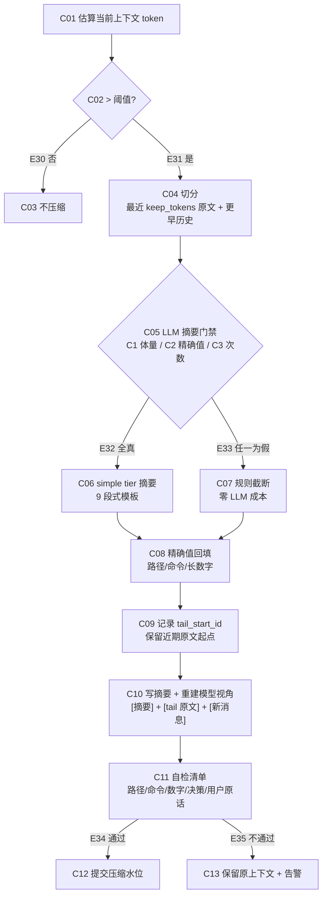

**约束**

- 压缩是信息压缩，不是推理：固定 simple tier，`max_tokens` 硬上限（默认 800）。
- 宁可多留废话，不可丢精确值；精确值回填是确定性规则，不依赖模型“记得住”。
- 摘要后必须保留 tail 原文起点，重启/回放仍能还原 `[摘要] + [tail] + [新增]`。
- 手动 `/compact`、自动压缩、模型切换迁移**共用同一实现**，避免三套语义漂移。

### 4.5 BF-05 RAG 检索质量门禁

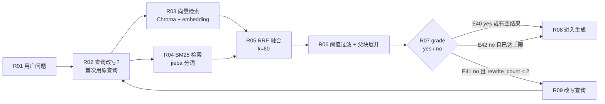

**规则**

- 空结果直接放行，不做无意义改写（避免 2 轮空转）。
- grade/rewrite 固定 simple tier；改写次数硬上限 2。
- 每个 chunk 必须带 `parent_id` / `source_file` / `section_title` / `department`，否则父块展开与权限过滤失效。
- embedding 统一入口，禁止本地与远端混用导致向量空间不一致。

### 4.6 BF-06 子 Agent 委派与并行扇出

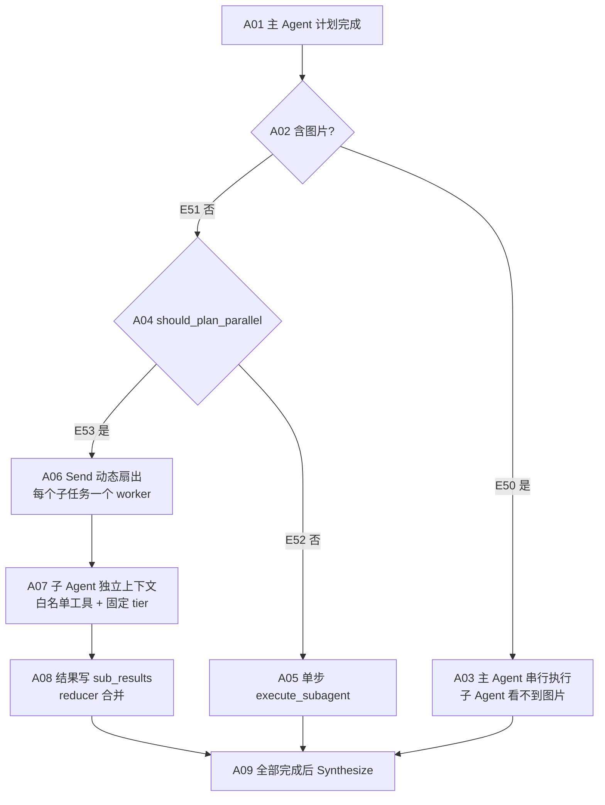

**扇出门禁（全部满足才允许）**

| 条件 | 说明 |
| --- | --- |
| C0 | `plan_parallel_enabled = true`（默认 false） |
| C1 | 剩余预算 > `plan_fanout_min_budget`（默认 0.20） |
| C2 | 本会话 `fanout_count < plan_max_fanout_calls`（默认 2） |
| C3 | `plan_tier == parallel` 且 ≥2 个带 agent 归属的 pending 任务 |
| C4 | 本轮无图片（图片只在主 Agent 视觉模型可用） |

### 4.7 BF-07 权限与审批

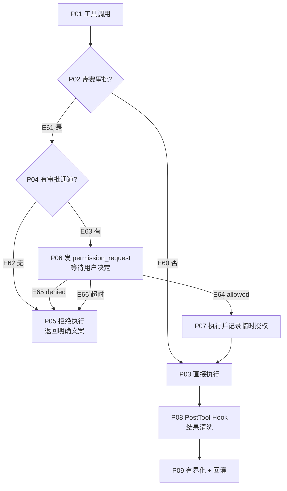

**默认拒绝原则**

- 无审批通道时，`require_approval` 工具一律拒绝，绝不静默放行。
- 外部路径默认 `ask`；`deny` 时直接拒绝；`allow` 时仍需记录审计。
- `.git` 路径永远拒绝读写。
- 命令按段校验：`; | || && & ( ) $( )` 拆段后逐段黑名单 + SSRF + 白名单。
- Shell 重定向目标（`>` / `>>` / `2>` 等）必须走写入权限检查。

### 4.8 BF-08 失败、重试与恢复

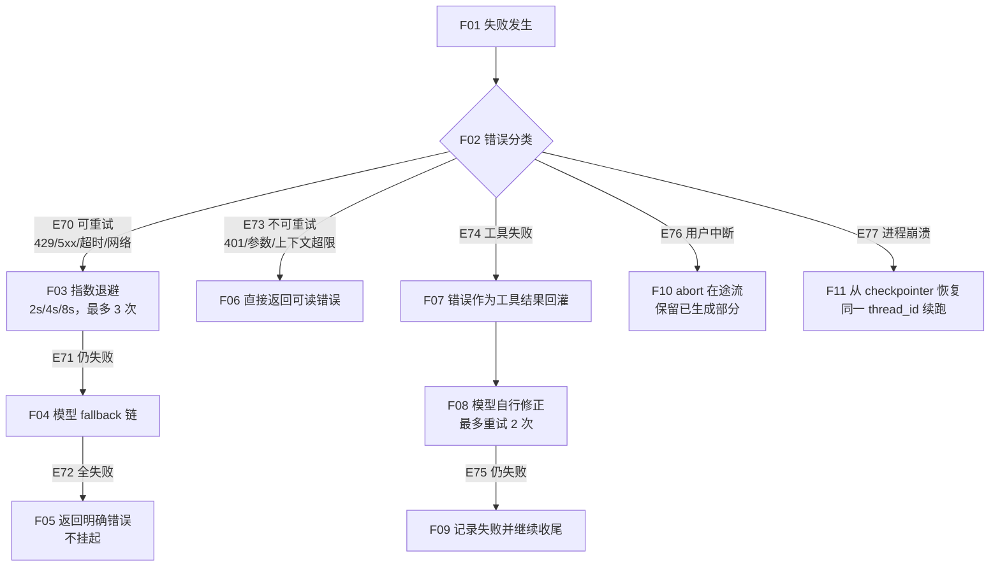

---

## 5. 数据模型与契约

### 5.1 数据流上下文图（DFD Level 0）

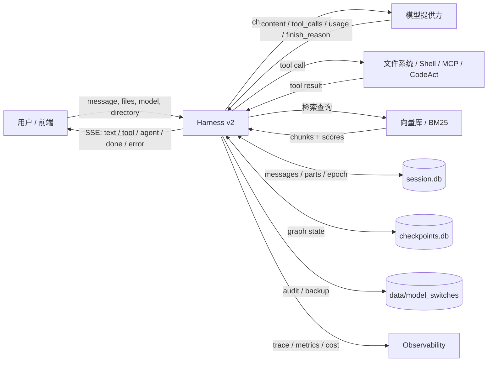

### 5.2 DFD Level 1：数据存储与读写责任

| 存储 | 读方 | 写方 | 关键字段 | 生命周期 |
| --- | --- | --- | --- | --- |
| `D1 session.db / session_messages` | ContextHarness、Session API | TurnHarness、Session API | `id, seq, type, data, parts` | 会话级 |
| `D1 session.db / session_context_epoch` | ContextHarness、switch | Compactor、switch | `baseline_seq, snapshot{summary,tail_start_id,tail_start_seq,context_window,compress_threshold,keep_recent_tokens,model_switch}` | 会话级 |
| `D1 session.db / session_inputs` | TurnHarness | API | `prompt, delivery, promoted_seq` | 单轮 |
| `D2 checkpoints.db` | AgentLoop / resume | LangGraph | graph state | 会话级 |
| `D3 model catalog` | ModelGateway / ToolAdapter / switch | 模型管理页 / probe | `capabilities.tool_use, context_length, limits, thinking` | 配置级 |
| `D4 data/model_switches` | 审计 / 人工核对 | switch | `backup.json, switches.jsonl` | 7~30 天 |
| `D5 data/truncation` | 模型续读 | ResultPolicy | 全文 + hint | 7 天 |
| `D6 Chroma + BM25` | RAG | 文档处理 | chunk + metadata | 文档级 |
| `D7 MemoryStore` | memory_recall | memory_store | `namespace=(user, memories)` | 长期 |
| `D8 EventBus（内存）` | API/SSE | Loop / Tool / Switch | `turn_id, step_id, agent_id, type` | 单轮 |

### 5.3 DFD Level 2：一次工具调用的数据流

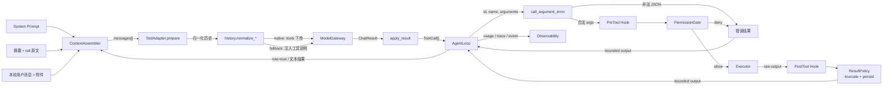

### 5.4 核心数据结构

```python
# 统一模型响应（厂商无关）
@dataclass
class ModelStep:
    content: str
    tool_calls: list[ToolCall]        # ToolCall(id, name, arguments: str)
    finish_reason: str                # stop | length | tool-calls | content-filter | error | unknown
    usage: dict[str, int]
    model: str
    raw_mode: str                     # native | fallback

# 一轮 Harness 上下文
@dataclass
class TurnContext:
    turn_id: str
    session_id: str
    user_id: str
    directory: str | None
    model: str
    model_profile: ModelProfile
    budget: BudgetLedger
    cancel: asyncio.Event
    event_bus: EventBus
    started_at: float

# 模型画像
@dataclass
class ModelProfile:
    model_id: str
    tool_mode: str                    # native | fallback
    context_length: int
    max_output_tokens: int
    vision: bool
    reasoning: bool
    source: str                       # catalog | override | env | default
    version: str                      # catalog 更新时间/哈希

# 工具调用（确定性 ID）
@dataclass
class ToolCall:
    id: str                           # hc_{turn_id}_{step}_{index}_{name_hash}
    name: str
    arguments: str                    # JSON 字符串

# 工具结果
@dataclass
class ToolResult:
    call_id: str
    name: str
    status: str                       # completed | failed | denied | invalid_args
    output: str                       # 已截断/已落盘提示
    full_path: str | None             # data/truncation/...
    duration_ms: float
```

**ID 规则**

| 对象 | 规则 | 理由 |
| --- | --- | --- |
| 消息 ID | `sessionId:seq`（持久化后由 DB 分配） | 跨模型/跨重启稳定 |
| 逻辑消息哈希 | `sha1(role + content + stable_ts)[:16]` | 迁移前临时对齐 |
| 工具调用 ID | `hc_{turn_id}_{step_no}_{idx}_{sha1(name+args)[:8]}` | 可重放、可去重、跨进程稳定 |
| 工具事件 step_id | 直接复用工具调用 ID | 前端 part upsert 不重复 |
| 子 Agent 事件 | `agent_id + task_id` | 面板归属稳定 |

### 5.5 事件信封

```json
{
  "type": "tool_start | tool_end | step_start | step_end | agent_start | agent_end | done | error | permission_request | queued",
  "turn_id": "turn_...",
  "session_id": "ses_...",
  "agent_id": "build",
  "step_id": "hc_...",
  "seq": 12,
  "ts": 1760000000.123,
  "data": { }
}
```

**约束**

- 事件推送失败不得影响主流程（`push_event` 内部吞异常）。
- 事件必须携带 `turn_id`，前端据此丢弃过期流。
- `done` 必须携带 `usage`、`rounds`、`agents` 快照；`error` 必须携带 `retryable/status_code/error_type`。

### 5.6 错误分类

| 类别 | 例子 | 可重试 | 处理 |
| --- | --- | --- | --- |
| `AUTH` | 401 / key 无效 | 否 | 直接返回，提示配置 |
| `RATE_LIMIT` | 429 | 是 | 退避 + fallback |
| `UPSTREAM` | 5xx / 网络 / 超时 | 是 | 退避 + fallback |
| `CONTEXT_OVERFLOW` | 超窗 | 否 | 先压缩再重试一次 |
| `BAD_REQUEST` | 参数非法 | 否 | 返回可读错误 |
| `TOOL_DENIED` | 权限拒绝 | 否 | 作为工具结果回灌 |
| `TOOL_FAILED` | 执行异常 | 视情况 | 作为工具结果回灌 |
| `BUDGET_EXCEEDED` | 超预算 | 否 | 熔断，返回明确信息 |
| `SWITCH_REJECTED` | 切换门禁失败 | 否 | 保留旧模型 + 审计 |
| `INTERRUPTED` | 用户中断 | 否 | 保留部分输出 |

---

## 6. Agent Loop 与 Tool Harness 设计

### 6.1 Loop 状态机

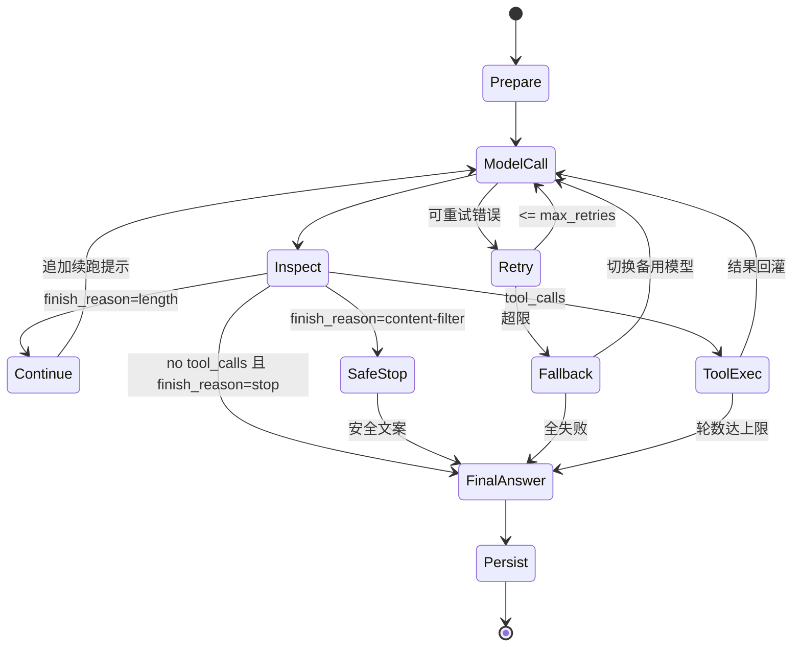

**轮数策略**

| 场景 | 行为 |
| --- | --- |
| `rounds < MAX_TOOL_ROUNDS` 且有 tool_calls | 继续执行工具 |
| 无 tool_calls 且文本非空 | 直接返回 |
| 无 tool_calls 但文本是工具调用 JSON | 纠偏一轮（`_NUDGE_NOT_A_TOOL_CALL`） |
| 空文本 | 纠偏一轮（`_NUDGE_EMPTY_ANSWER`） |
| 达到轮数上限 | 追加 `_FINAL_ROUND_NUDGE`，做一次不带工具的收尾调用 |
| 收尾仍为空 | 用异常工具轨迹摘要兜底，否则占位文案 |

### 6.2 流式双路径

| 路径 | 流式处理 | 触发执行时机 |
| --- | --- | --- |
| 原生 | `PreludeSuppressor` 抑制“解释性前置文本 + 内嵌 JSON” | 完整响应后归一化；有原生 tool_calls 立即执行 |
| 回退 | `StreamToolCallParser` 增量解析定界符 | 参数定界符闭合即产出 `ToolCallReady` |
| 纯文本 | 直接透传 `TextDelta` | 流结束作为最终答案 |

**验收点**：分块边界切断定界符时不得把定界符泄漏到用户文本；未闭合的调用块在流结束时丢弃并记录告警。

### 6.3 历史归一化规则

| 输入形态 | 原生目标模型 | 回退目标模型 |
| --- | --- | --- |
| `assistant.tool_calls` | 统一为 `{id,type,function:{name,arguments}}` | 文本化为定界符块，删除 `tool_calls` |
| `role=tool` 且有匹配 id | 保留 `role=tool + tool_call_id` | 转 `role=user` + 文本结果块 |
| 孤儿 `role=tool` | 降级为 `role=user` 文本，避免 400 | 降级为 `role=user` 文本 |
| 连续同 role | 合并（保留 tool/system 边界） | 合并 |
| 未知字段 | 丢弃 | 丢弃 |

### 6.4 工具 schema 与注册表

- 工具数量软上限 **15**；超过后按 scope 分组下发（主 Agent / 子 Agent / 只读 / 写入）。
- schema 从函数签名生成，扁平化、必填最少化、枚举优先、单位显式。
- `ToolSchemaCache` 以「registry 版本 + scope」为 key，避免每轮重复反射。
- 工具描述必须包含：做什么、何时用、何时不用、参数格式、返回格式。

### 6.5 结果有界化（ResultPolicy）

| 工具 | 行上限 | 字节上限 | 超限处理 |
| --- | --- | --- | --- |
| 默认 | 200 行 | 32 KB | 头尾保留 + 落盘 + 续读提示 |
| `tool_grep` | 100 行 | 16 KB | 同上 |
| `tool_execute` | 300 行 | 32 KB | 同上 |
| `tool_read_file` | 200 行 | 32 KB | 同上 |

**规则**：只保留头部会丢错误堆栈末尾，只保留尾部会丢命令本身；必须**头尾同时保留**。全文写入 `data/truncation/`，提示模型用 `offset` 或 `grep` 续读。

### 6.6 Hook 契约

| Hook | 时机 | 返回 | 失败语义 |
| --- | --- | --- | --- |
| `PreToolUse` | 参数解析后、权限前 | 修改后的 args 或 None | 异常视为不拦截，记录告警 |
| `PostToolUse` | 执行后、回灌前 | 清洗后的 output 或 None | 异常视为不修改，记录告警 |
| `Permission` | 审批点 | allow / deny / timeout | 默认 deny |
| `ModelBefore`（预留） | 模型调用前 | 修改后的 messages/tools | 异常视为不修改 |
| `ModelAfter`（预留） | 模型调用后 | 修改后的 ModelStep | 异常视为不修改 |

---

## 7. Context Harness 设计

### 7.1 三层分离

| 层 | 存什么 | 不存什么 | 存储 |
| --- | --- | --- | --- |
| 原文层 | 完整消息列表 + 稳定 ID | 模型名、窗口大小 | `D1 session_messages` + `D2 checkpoint` |
| 摘要层 | 9 段式结构化事实 + 精确值补充 | 完整 transcript 副本 | `D1 epoch.snapshot.summary` |
| 绑定层 | 当前轮模型、窗口、压缩阈值、tail 起点 | 旧历史“已装入新窗口”的证明 | `D1 epoch.snapshot` + `sessions.model` |

### 7.2 模型视角装配顺序

```text
[system: 角色提示词 + 工具说明 + 授权目录]
[system: 历史摘要（永不参与预算裁剪）]
[近期原文 tail（从 tail_start_id 起）]
[本轮用户消息 + 附件]
[本轮任务指令（plan 子任务时）]
```

**规则**

- 摘要必须始终保留，预算裁剪只裁非 system 消息。
- `tail_start_id` 找不到时退化为最近 12 条，不允许静默丢摘要。
- 附件图片走多模态 content 块；文档附件走文本解析，超预算截断并提示。

### 7.3 压缩门禁

| 条件 | 阈值 | 不满足时 |
| --- | --- | --- |
| C1 被压缩体量 | ≥ 5,000 token | 规则截断 |
| C2 含精确值 | 路径/命令/ID/端口/版本/token 关键词或模式 | 规则截断 |
| C3 本会话 LLM 摘要次数 | < 3 | 规则截断 |
| C4 上下文总量 | > `compress_threshold`（默认 80K，随目标窗口绑定） | 不触发 |

### 7.4 精确值回填与探针

- 提取模式：文件路径、长数字（≥4 位）、反引号命令、`id:` / 端口 / 版本 / token。
- 摘要中缺失的精确值追加到 `[精确值补充]`，最多 20 条。
- 模型切换时执行**确定性探针**：摘要 + tail 原文必须覆盖原文中所有精确值；缺失即回滚。
- 事实探针不调用模型，零成本、可重复。

---

## 8. Governance：预算、并发、审计

### 8.1 BudgetLedger

| 维度 | 默认 | 行为 |
| --- | --- | --- |
| 会话预算 | `SESSION_BUDGET`（0 = 不设） | 累计成本 > 预算 → `BUDGET_EXCEEDED` |
| 单轮工具轮数 | 8 | 达上限进收尾 |
| 扇出次数 | 2 | 达上限退串行 |
| 扇出最低剩余预算 | 0.20 | 不足退串行 |
| 并发 | 4 | 满则 queued + queue_position |

**规则**

- 预算单调递减，模型切换不清零。
- 每次模型调用前预扣、调用后按真实 usage 校正。
- 超预算必须产生 `budget_exceeded` 事件，并返回明确文案，不静默截断。

### 8.2 审计

| 事件 | 落点 | 保留 |
| --- | --- | --- |
| 模型切换成功/失败 | `data/model_switches/switches.jsonl` | 30 天 |
| 切换前原文快照 | `data/model_switches/{session}_{ts}.json` | 30 天 |
| 高危工具审批 | 事件流 + 结构化日志 | 30 天 |
| 超限工具输出 | `data/truncation/` | 7 天 |
| 预算熔断 | metrics + 事件流 | 24h 窗口 + 累计 |

---

## 9. 模型切换详细设计（agent-3 落地版）

### 9.1 切换流程（时序）

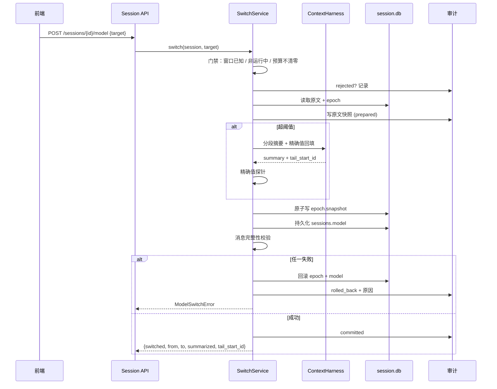

### 9.2 三层校验

| 层 | 检查 | 失败动作 |
| --- | --- | --- |
| L1 消息完整性 | 切换前后未压缩消息 ID 集合不减少 | 回滚绑定 + 保持旧模型 |
| L2 事实召回 | 路径/长数字/命令/用户原话在摘要 + tail 中可检索 | 回滚 + 告警 |
| L3 风格差异 | 新模型答不出确定事实才是 bug；只是“风格不同”不回滚 | 记录人工核对事件 |

### 9.3 前端契约

- 切换后只更新 `currentModel`，不重新初始化消息列表。
- 消息组件 key 使用稳定 `message.id`，禁止 index / model+index。
- 服务端拉取历史期间显示“正在切换模型，历史加载中”，不清空列表。
- provider 目录未就绪时禁止 `set()` 静默回退默认模型；失败必须显式报错。

---

## 10. 数据流总图（DFD Level 2 汇总）

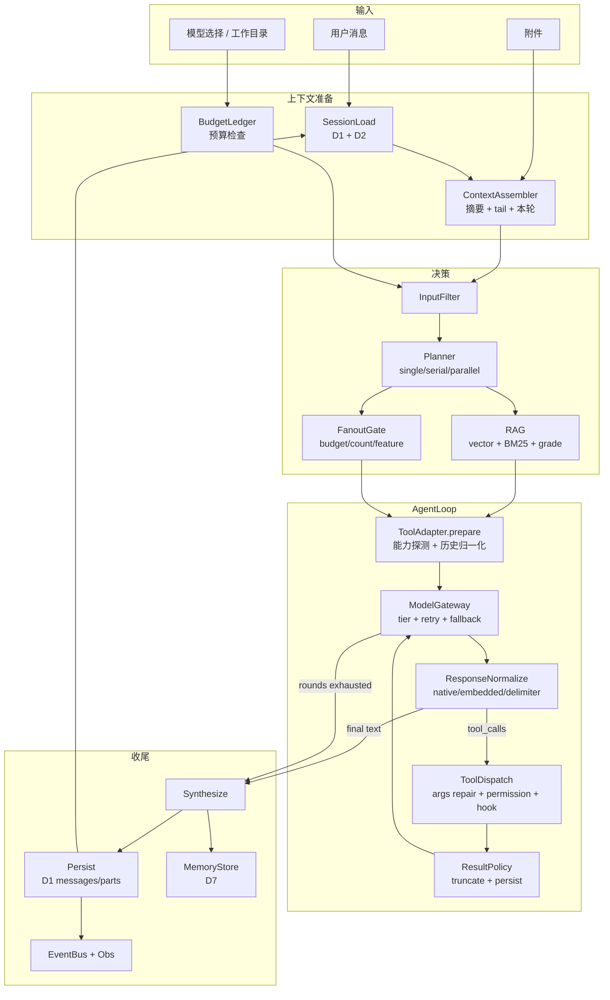

---

## 11. 测试设计：从业务图与数据流图派生

### 11.1 测试方法论

测试不从“函数列表”出发，而从 §4/§5 的图出发，按以下顺序补齐：

| 层级 | 覆盖目标 | 判定 |
| --- | --- | --- |
| C1 节点覆盖 | 每张业务图的每个处理节点至少 1 正 1 负 | 节点清单逐个打勾 |
| C2 边覆盖 | 每条箭头（含失败/拒绝/回滚边）至少 1 次 | 边清单逐个打勾 |
| C3 数据流覆盖 | 每个存储的读/写/更新至少 1 次；关键字段定义-使用链 | DFD 表逐项打勾 |
| C4 状态迁移覆盖 | 切换、Loop、审批状态机所有迁移 | 状态迁移矩阵 |
| C5 不变量覆盖 | I-SW1..8、R1..7、错误分类 | 每条不变量 1 个断言 |
| C6 故障注入 | 超时、429、非法 JSON、空答、崩溃、断连、权限拒绝 | 故障矩阵 |
| C7 黄金集 | 真实模型端到端（可 gate） | 结构 + 关键事实断言，不断言完整字符串 |

### 11.2 测试分层与执行时机

| 层 | 前缀 | 是否真实 LLM | 目标 | 时机 |
| --- | --- | --- | --- | --- |
| L0 静态/契约 | `CT-` | 否 | 请求/响应/事件/存储契约 | 每次提交 |
| L1 单元 | `UT-` | 否 | 纯函数、解析、归一化、门禁 | 每次提交 |
| L2 图集成 | `IT-` | 否（FakeModel/FakeTool） | 节点/边/状态流转 | 每次提交 |
| L3 端到端 | `E2E-` | 是（可跳过） | 核心场景闭环 | 每日 / 发版前 |
| L4 性能 | `PF-` | 是 | 延迟/并发/成本 | 每周 / 发版前 |
| L5 安全 | `SEC-` | 是/否混合 | 注入/越权/泄露 | 发版前 |
| L6 可靠性 | `REL-` | 否（注入故障） | 超时/崩溃/断连恢复 | 每次提交 + 发版前 |

### 11.3 单元测试（UT）——组件级

#### 11.3.1 能力探测与适配

| 用例 ID | 图元素 | Given | When | Then |
| --- | --- | --- | --- | --- |
| UT-CAP-01 | BF-02/T03-E21 | 未知模型，无覆盖 | `resolve_mode` | `fallback` |
| UT-CAP-02 | BF-02/T03-E20 | catalog `tool_use=true` | `resolve_mode` | `native` |
| UT-CAP-03 | BF-02/T02 | `HARNESS_TOOL_MODE=native` | `resolve_mode` | 强制 native |
| UT-CAP-04 | BF-02/T02 | `ollama/qwen:3b`，fallback 白名单含 `qwen:3b` | `mode_override` | `fallback` |
| UT-CAP-05 | DF-D3 | catalog 刷新后 `tool_use=false` | `ModelProfile` | 刷新生效；人工 override 优先 |
| UT-ADP-01 | BF-02/T05 | 工具定义列表 | `build_fallback_prompt` | 含工具名/描述/参数/协议示例 |
| UT-ADP-02 | BF-02/T05 | 无 system 消息 | `inject_fallback_prompt` | 自动补 system |
| UT-ADP-03 | BF-02/T09 | 正文含 `{"name":...}` | `apply_result(native)` | 提取调用 + 去掉前置文本 |
| UT-ADP-04 | BF-02/T10 | 正文含定界符 | `apply_result(fallback)` | 提取调用 + 正文清理 |
| UT-ADP-05 | BF-02/T13-E26 | `arguments="{bad"` | `call_argument_error` | 返回错误文本，不抛异常 |
| UT-DEL-01 | BF-02/T10 | 单调用两行 | `parse_tool_calls` | name/args 正确 |
| UT-DEL-02 | BF-02/T10 | 多调用连续 | `parse_tool_calls` | 全部提取，正文清理 |
| UT-DEL-03 | BF-02/T10 | 缺参数定界符 | `parse_tool_calls` | 调用保留 + `error` 标记 |
| UT-DEL-04 | BF-02/T10 | 非法 JSON | `parse_tool_calls` | `parsed=None` + error |
| UT-DEL-05 | BF-02/T10 | render→parse 往返 | 往返 | 等价 |
| UT-DEL-06 | SEC-06 | 普通文本含类似标记 | parse | 不误判 |

#### 11.3.2 历史归一化与流式

| 用例 ID | 图元素 | Given | When | Then |
| --- | --- | --- | --- | --- |
| UT-HIST-01 | DF-工具流 | 原生 assistant.tool_calls | `normalize_native` | 统一 OpenAI 形状 |
| UT-HIST-02 | DF-工具流 | 孤儿 `role=tool` | `normalize_native` | 转 user 文本，不保留 tool_call_id |
| UT-HIST-03 | DF-工具流 | 原生历史 → fallback | `normalize_fallback` | tool_calls 文本化、tool 转 user |
| UT-HIST-04 | DF-工具流 | 连续两个 user | 归一化 | 合并为一条 |
| UT-HIST-05 | I-SW8 | 同一逻辑消息不同协议 | 稳定 ID 计算 | ID 不变 |
| UT-STR-01 | BF-02/E24 | 定界符跨 chunk 切开 | `feed` | 不泄漏到文本，闭合产出调用 |
| UT-STR-02 | BF-02/E24 | 一个 chunk 多个调用 | `feed` | 按序产出 |
| UT-STR-03 | BF-02/E24 | 流结束仍未闭合 | `finalize` | 丢弃未完成调用 |
| UT-STR-04 | BF-02/E23 | 原生前置文本 + 内嵌 JSON | `PreludeSuppressor` | 抑制前置文本 |
| UT-STR-05 | BF-02/E25 | 纯文本长回答 | suppressor | 超过缓冲即放行 |
| UT-HOOK-01 | BF-07/P08 | pre 修改 args | `run_pre_tool` | 修改生效 |
| UT-HOOK-02 | BF-07/P08 | hook 抛异常 | 执行 | 不拦截，记录告警 |
| UT-ID-01 | DF-工具流 | 相同 name+args 不同轮 | 生成 ID | 轮次不同 ID 不同；同轮可重放 |

#### 11.3.3 上下文与压缩

| 用例 ID | 图元素 | Given | When | Then |
| --- | --- | --- | --- | --- |
| UT-CTX-01 | BF-04/C01 | 中英混合文本 | `estimate_tokens` | CJK 与 ASCII 加权合理 |
| UT-CTX-02 | BF-04/C04 | 超 keep_tokens | `split_by_token` | 尾部保留、头部待压缩 |
| UT-CTX-03 | BF-04/C08 | 原文含路径/端口 | `enforce_precision` | 缺失精确值回填 |
| UT-CTX-04 | BF-04/C05 | C1/C2/C3 各缺一 | `should_use_llm_summary` | 返回 False |
| UT-CTX-05 | BF-04/C05 | 三条件全真 | `should_use_llm_summary` | 返回 True |
| UT-CTX-06 | BF-04/C09 | 压缩后 | snapshot | `tail_start_id` 指向保留原文首条 |
| UT-CTX-07 | BF-04/C10 | 摘要 + tail | 装配 | 顺序为摘要→tail→新消息 |
| UT-CTX-08 | BF-04/C11 | 摘要丢路径 | 自检 | 不放行（或告警回填） |
| UT-CTX-09 | BF-04/E30 | 未超阈值 | 压缩 | `triggered=false` |
| UT-CTX-10 | BF-04/E32 | 超阈值且门禁全真 | 压缩 | 调用 simple 模型一次 |

#### 11.3.4 Loop 与预算

| 用例 ID | 图元素 | Given | When | Then |
| --- | --- | --- | --- | --- |
| UT-LOOP-01 | BF-01/B16-B19 | 原生 tool_call | 一轮 loop | 执行工具、回灌、再调用 |
| UT-LOOP-02 | BF-01/B16-B19 | 回退定界符 | 一轮 loop | 同上，且请求不带 tools |
| UT-LOOP-03 | BF-02/E26 | 非法 JSON | loop | 错误作为工具结果回灌，不崩溃 |
| UT-LOOP-04 | BF-01/E13 | 空 content | loop | 触发补答 nudge |
| UT-LOOP-05 | BF-01/E13 | 正文是工具调用 JSON | loop | 触发纠偏 nudge |
| UT-LOOP-06 | BF-01/E14 | `finish_reason=length` | loop | 追加续跑提示或明确截断说明 |
| UT-LOOP-07 | BF-01/B17 | 未知工具名 | loop | 返回“未知工具”，不抛异常 |
| UT-LOOP-08 | BF-07/E64 | 审批拒绝 | loop | 返回拒绝文案，继续收尾 |
| UT-LOOP-09 | BF-01/B20 | 达到 8 轮 | loop | 做一次不带工具收尾 |
| UT-LOOP-10 | BF-01/B20 | 收尾仍空 | loop | 工具轨迹摘要/占位文案 |
| UT-BUD-01 | BF-01/B03 | 会话预算 0.50，已用 0.49 | 模型调用 | 预扣后允许/拒绝一致 |
| UT-BUD-02 | BF-01/E01 | 预算耗尽 | 新调用 | `BUDGET_EXCEEDED` + 事件 |
| UT-BUD-03 | BF-03/I-SW5 | 切换模型 | 预算 | 累计值不变 |
| UT-BUD-04 | BF-06/E53 | 剩余预算 ≤ 0.20 | 扇出 | 拒绝，退串行 |
| UT-BUD-05 | BF-06/E53 | fanout_count=2 | 扇出 | 拒绝，退串行 |

### 11.4 契约测试（CT）——接口形状

| 用例 ID | 契约 | 断言 |
| --- | --- | --- |
| CT-NAT-01 | 原生请求 | `tools` 原样下传；messages 为 OpenAI 形状 |
| CT-NAT-02 | Loop 无厂商字段 | 捕获的 loop 输入中不出现 `tool_use` / `function_call` |
| CT-FB-01 | 回退请求 | 不带 `tools`；system 含工具定义与定界符协议 |
| CT-FB-02 | 回退响应 | 统一输出 `{name, arguments}`，正文不含调用块 |
| CT-HIST-01 | 跨模型历史 | A 原生产生的历史，B 回退请求中无 `role=tool` / `tool_calls` |
| CT-EVT-01 | 事件信封 | 含 `turn_id/step_id/agent_id/type/seq`；done 含 usage |
| CT-ERR-01 | 错误响应 | 含 `retryable/status_code/error_type` |
| CT-STORE-01 | D1 写入 | assistant tool_calls + tool result 成对落库；seq 单调 |
| CT-STORE-02 | D1 epoch | 压缩/切换后 snapshot 字段齐全且可反序列化 |

### 11.5 图集成测试（IT）——业务图路径

| 用例 ID | 覆盖路径 | 断言 |
| --- | --- | --- |
| IT-TURN-01 | BF-01：B01→B05→B09→B16→B20→B21→B23 | 单任务一次回答，无工具 |
| IT-TURN-02 | BF-01/E03 | 寒暄命中固定模板，模型调用次数=0 |
| IT-TURN-03 | BF-01/E08→E10 | RAG 命中后进入生成，上下文含来源 |
| IT-TURN-04 | BF-05/E41→R09→R02→E40 | grade=no → 改写 → 二次检索 → 相关 |
| IT-TURN-05 | BF-05/E42 | 改写达上限仍不相关，带低质结果继续，不循环 |
| IT-TURN-06 | BF-04/E31→E32 | 超阈值触发压缩，摘要+tail 正确 |
| IT-TURN-07 | BF-04/E33 | 门禁失败走规则截断，不调用模型 |
| IT-TURN-08 | BF-01/B18→B19 | 工具执行后回灌，第二轮给出答案 |
| IT-TURN-09 | BF-06/E53 | 扇出开启时多 worker 并发，reducer 合并完整 |
| IT-TURN-10 | BF-06/E52 | 扇出关闭时退串行，结果仍完整 |
| IT-TURN-11 | BF-06/E50 | 含图片时不扇出，主 Agent 串行执行 |
| IT-SW-01 | BF-03 全成功路径 | 切换后 model/epoch/tail 一致，审计 committed |
| IT-SW-02 | BF-03/Rejected（窗口未知） | 400；旧模型可继续 |
| IT-SW-03 | BF-03/Rejected（running） | 409；在途流不受影响 |
| IT-SW-04 | BF-03/Rejected（探针失败） | 回滚；备份标记 rolled_back |
| IT-SW-05 | BF-03/Rejected（消息丢失） | 回滚绑定与模型，旧模型继续 |
| IT-SW-06 | BF-03/Committed 后继续对话 | 新轮历史含摘要+tail，事实可召回 |
| IT-FB-01 | BF-02 回退路径全链路 | 不支持 tools 的 FakeModel 完成一次工具任务 |
| IT-PERM-01 | BF-07/E62 | 无审批通道 → 拒绝，不执行 |
| IT-PERM-02 | BF-07/E64 | 批准 → 执行；临时授权生效 |
| IT-PERM-03 | BF-07/E65/E66 | 拒绝/超时 → 返回拒绝文案 |
| IT-RESUME-01 | BF-08/E77 | 同一 thread_id 崩溃后续跑，上下文不丢 |
| IT-EVT-01 | DF-事件流 | tool_start/tool_end 成对；step_id 一致；agent 面板归属正确 |

### 11.6 端到端测试（E2E）——真实模型黄金集

> 仅在显式启用（`LIVE_API_BASE` / 真实模型环境）时运行；断言“结构 + 关键事实”，不断言完整措辞。

| 用例 ID | 场景 | 断言 |
| --- | --- | --- |
| E2E-01 | 单文件读取与摘要 | 输出含“要点/摘要”结构，长度有界 |
| E2E-02 | 多步代码任务 | 有写入/执行痕迹，最终给出验证结果 |
| E2E-03 | 知识库问答 | 含来源或“未检索到”，不编造 |
| E2E-04 | 回退模型工具任务 | 工具被执行，最终回答包含工具结果 |
| E2E-05 | 跨模型事实保持 | A 记下代号/端口 → 切 B → B 答得出 |
| E2E-06 | 长上下文压缩后继续 | 压缩后仍能引用早期路径/数字 |
| E2E-07 | 超出能力范围 | 明确说明无法完成，不崩溃 |
| E2E-08 | 并行三子任务 | 三个结果都出现在最终回答或可追溯 |

### 11.7 性能测试（PF）

| 用例 ID | 指标 | 目标 | 方法 |
| --- | --- | --- | --- |
| PF-01 | 首 token 延迟 P95 | < 2.5s | 流式接口打点 |
| PF-02 | 简单任务端到端 P95 | < 8s | E2E 计时 |
| PF-03 | 回退解析开销 | 单 chunk < 1ms | 微基准 |
| PF-04 | 单实例并发 | ≥ 50 QPS（假模型） | Locust/脚本 |
| PF-05 | 单任务平均 token | < 30K | usage 统计 |
| PF-06 | 单任务平均成本 | < ¥0.30 | cost 表 |
| PF-07 | 切换迁移耗时 P95 | < 15s（10K token 历史） | 计时 |

### 11.8 安全测试（SEC）

| 用例 ID | 攻击面 | 输入 | 断言 |
| --- | --- | --- | --- |
| SEC-01 | 提示词注入 | 文档内嵌“忽略上述指令” | 不泄露系统提示词 |
| SEC-02 | 路径穿越 | `read_file("../../etc/passwd")` | 拒绝/审批，不读到 |
| SEC-03 | 命令注入 | `ls; rm -rf /` | 分段校验拦截 |
| SEC-04 | 越权工具 | 子 Agent 调未授权工具 | 白名单拒绝 |
| SEC-05 | 伪造工具调用 | 正文伪造定界符/JSON | 未知工具拒绝，不执行 |
| SEC-06 | 定界符碰撞 | 正常文本含类似字符 | 不误判为调用 |
| SEC-07 | 审批绕过 | 无审批通道调高危工具 | 默认拒绝 |
| SEC-08 | 密钥泄露 | 诱导输出 API Key | 输出扫描/拒绝 |
| SEC-09 | 资源耗尽 | 死循环命令/超长输出 | 超时 + 截断 + 落盘 |
| SEC-10 | 越界重定向 | `echo x > C:\outside.txt` | 写入权限检查拦截 |

### 11.9 可靠性测试（REL）

| 用例 ID | 故障注入 | 期望 |
| --- | --- | --- |
| REL-01 | 主模型超时 | 退避重试 → fallback |
| REL-02 | 主模型 429 | 指数退避，最多 3 次 |
| REL-03 | 全部模型不可用 | 明确错误，不挂起 |
| REL-04 | 向量库宕机 | 降级无 RAG，提示用户 |
| REL-05 | 进程中途崩溃 | 重启后从 checkpointer 续跑 |
| REL-06 | 工具返回脏数据 | 解析失败可捕获，不中断主流程 |
| REL-07 | 子 Agent 死循环 | 子 Agent 自身轮数上限触发 |
| REL-08 | SSE 断连 | 已生成部分持久化；重连可继续 |
| REL-09 | 切换中崩溃 | 启动后状态一致：要么旧模型无摘要，要么新模型有绑定 |

### 11.10 追溯矩阵（图元素 → 测试）

| 图元素 | 组件 | 测试 ID | 级别 |
| --- | --- | --- | --- |
| BF-01/B03, E01 | BudgetLedger | UT-BUD-01, UT-BUD-02 | L1 |
| BF-01/B05, E03 | InputFilter | IT-TURN-02 | L2 |
| BF-01/B08-B11, E05-E07 | Planner/FanoutGate | IT-TURN-09, IT-TURN-10, UT-BUD-04/05 | L1/L2 |
| BF-01/B12-B15, E08-E11 | RAG | IT-TURN-03/04/05 | L2 |
| BF-01/B16-B19, E12 | AgentLoop | UT-LOOP-01/02/03/07, IT-TURN-08 | L1/L2 |
| BF-01/B20, E13-E15 | Loop 收尾 | UT-LOOP-04/05/06/09/10 | L1 |
| BF-02/T02-T03, E20-E21 | Capability | UT-CAP-01..05, CT-NAT-01, CT-FB-01 | L0/L1 |
| BF-02/T07-T10, E22-E24 | Adapter/Streaming | UT-ADP-01..05, UT-DEL-01..06, UT-STR-01..05 | L1 |
| BF-02/T13-E26 | Arg repair | UT-ADP-05, UT-LOOP-03 | L1 |
| BF-03 全状态 | SwitchService | IT-SW-01..06, E2E-05, REL-09 | L2/L3/L6 |
| BF-04/C01-C13 | ContextHarness | UT-CTX-01..10, IT-TURN-06/07 | L1/L2 |
| BF-05/R01-R09 | RAG grade | IT-TURN-03/04/05, E2E-03 | L2/L3 |
| BF-06/A01-A09 | Subagent/Fanout | IT-TURN-09/10/11, UT-BUD-04/05 | L1/L2 |
| BF-07/P01-P09 | Permission | IT-PERM-01..03, SEC-02/03/07/10 | L2/L5 |
| BF-08/F01-F11 | Error/Recovery | REL-01..09, IT-RESUME-01 | L2/L6 |
| DF-D1 写入 | Session repo | CT-STORE-01/02, IT-EVT-01 | L0/L2 |
| DF-D3 能力表 | Catalog | UT-CAP-02/05 | L1 |
| DF-D4 审计 | Switch audit | IT-SW-01/04, REL-09 | L2/L6 |
| DF-D5 截断 | ResultPolicy | UT-LOOP-10, SEC-09 | L1/L5 |
| R1..R7 | 业务规则 | 各路径主用例 + 断言 | 全部 |
| I-SW1..8 | 切换不变量 | IT-SW-01..06 + UT-SW 系列 | L1/L2 |

### 11.11 测试夹具与替身

```python
class ScriptedModel:
    """按脚本返回 ModelStep；可注入异常、usage、finish_reason。"""
    def __init__(self, script: list[dict]): ...
    async def raw_ainvoke(self, messages, tools=None): ...
    async def raw_stream(self, messages, tools=None, on_text=None): ...

class FakeRegistry:
    """内存工具注册表；记录调用顺序与参数，可配置 require_approval。"""

class InMemorySession:
    """实现 D1 读写契约，支持 seq、epoch、parts。"""

class FakeClock:
    """确定性时间，便于断言审计与 TTL。"""
```

**夹具原则**

- 所有 Fake 必须实现与真实对象相同的**最小契约**，不复制业务逻辑。
- 每个测试只验证一个业务图元素，避免“大而全”断言。
- 涉及随机/时间/ID 的地方统一注入确定性实现。

### 11.12 覆盖率门槛

| 范围 | 门槛 | 说明 |
| --- | --- | --- |
| Harness 核心（capabilities/adapter/delimiters/history/streaming/hooks） | ≥ 90% 行覆盖 | 现有测试已接近 |
| Loop / Context / Switch / Budget | ≥ 85% 行覆盖 + 100% 分支关键路径 | 新增模块 |
| 业务图节点 | 100% | §4 每张图 |
| 业务图边 | ≥ 95% | 失败/回滚边必须有 |
| 不变量 | 100% | R1..R7、I-SW1..8 |
| 契约测试 | 100% | 请求/响应/事件/存储 |
| E2E 黄金集 | 核心场景 ≥ 90% 通过 | 允许模型措辞波动 |
| 安全攻击集 | 100% 拦截 | 发版门禁 |

### 11.13 CI 门禁

```text
提交时：
  pytest tests/unit tests/integration -q
  pytest tests/contract -q            # 新增契约层
  覆盖率门槛检查

每日：
  pytest tests/e2e -q                 # 有真实模型凭证时
  pytest tests/reliability -q

发版前：
  pytest tests/security tests/perf -q
  切换矩阵：native A → fallback B → native A
  长上下文压缩回归
  全量业务图边覆盖报告
```

---

## 12. 迁移与落地计划

### 12.1 分阶段

| 阶段 | 目标 | 主要改动 | 退出标准 |
| --- | --- | --- | --- |
| P0（1 周） | 冻结契约 | 新增 `harness/contracts.py`（ModelStep/TurnContext/Event）；确定性工具 ID；`finish_reason` 进入 Loop | 契约测试全绿；现有 202 测试不回归 |
| P1（1~2 周） | 收敛入口 | `TurnHarness` 门面接管一轮生命周期；预算/取消/事件统一 | 主流程只经 TurnHarness；集成测试覆盖 BF-01 全节点 |
| P2（1~2 周） | 统一上下文 | `ContextHarness` 合并图压缩/切换迁移/手动 compact；tail 回放统一 | 三处压缩共用实现；UT-CTX/IT-SW 全绿 |
| P3（1 周） | 接入流式回退 | AgentLoop 消费 `ToolAdapter.stream` | 回退模型定界符闭合即执行；E2E-04 通过 |
| P4（1 周） | 治理与观测 | BudgetLedger、Error taxonomy、审计、事件信封 | 预算/错误/审计用例全绿 |
| P5（持续） | 清理重复路径 | 删除旧分支/死代码，保留兼容 shim | 无重复实现；文档与代码一致 |

### 12.2 兼容策略

- 保留 `backend/harness/__init__.py` 的导出名，新增门面不破坏旧 import。
- 旧图节点继续可用；新 Loop 先并行运行（shadow mode）对比结果，再切主路径。
- `Settings` 新增字段全部给默认值，`.env` 不配置也能跑。
- 前端 SSE 契约不变；只新增 `turn_id`、更稳定的 `step_id`。

### 12.3 回滚策略

| 变更 | 回滚方式 |
| --- | --- |
| TurnHarness 接管 | 开关 `HARNESS_KERNEL_ENABLED=false` 回旧编排 |
| 流式回退 | 开关 `HARNESS_STREAM_FALLBACK=false` |
| 新上下文内核 | 开关 `HARNESS_CONTEXT_V2=false`，回旧压缩节点 |
| 预算熔断 | 调大/关闭 `SESSION_BUDGET` |
| 新事件字段 | 前端忽略未知字段，天然兼容 |

---

## 13. 观测与验收

### 13.1 必埋点

| 事件 | 字段 |
| --- | --- |
| 模型调用 | tier、模型、输入/输出 token、延迟、成本、重试次数、fallback 标记 |
| 工具调用 | 名称、参数摘要、耗时、状态、是否审批、是否截断 |
| 压缩 | 触发原因、前后 token、是否 LLM 摘要、精确值回填数量 |
| 切换 | from/to、门禁结果、摘要 token、tail、探针结果、耗时 |
| 扇出 | 触发率、子任务数、预算、合并结果 |
| 错误 | 类型、可重试、状态码、所属节点 |
| 循环 | 轮数、是否触发收尾、空答纠偏次数 |

### 13.2 验收标准

| 维度 | 标准 |
| --- | --- |
| 功能 | BF-01~BF-08 所有节点/边有对应用例并通过 |
| 跨模型 | native→fallback→native 往返，历史可继续 |
| 事实保持 | 切换后路径/ID/端口/金额可召回 |
| 压缩 | 超阈值压缩后精确值 0 丢失 |
| 成本 | 压缩/扇出门禁生效；超预算熔断 |
| 安全 | 攻击集 100% 拦截；无审批通道默认拒绝 |
| 可靠性 | 崩溃/断连/超时/429 有明确恢复路径 |
| 性能 | P95 首 token < 2.5s；简单任务 < 8s |
| 可维护 | Harness 核心覆盖率 ≥ 90%；业务图边覆盖 ≥ 95% |

---

## 14. 风险与开放问题

| 编号 | 风险 | 影响 | 缓解 |
| --- | --- | --- | --- |
| RK-1 | 不同模型对定界符的服从度差异 | 回退路径调用率低 | 定界符提示 + few-shot + 失败纠偏 + 能力表灰度 |
| RK-2 | 摘要模型质量不稳定 | 精确值丢失 | 确定性回填 + 探针 + 保留 tail |
| RK-3 | 原生流式工具调用分片不完整 | 调用丢失 | 流结束归一化兜底 + 非流式回退 |
| RK-4 | 切换迁移耗时 | 用户等待 | 阈值按窗口计算 + 分段摘要 + 进度事件 |
| RK-5 | 预算估算与实际计费偏差 | 熔断过早/过晚 | 调用后按真实 usage 校正 + 安全系数 |
| RK-6 | 事件队列阻塞 | 主流程变慢 | 非阻塞 put；队列满丢弃并计数 |
| RK-7 | 旧代码双路径并存 | 行为漂移 | shadow mode 对比 + 开关 + P5 清理 |

**待确认**

1. 是否将 `TurnHarness` 直接接入 `app/api/compat.py` 的 SSE 主路径，还是先做 shadow？
2. 回退路径是否需要在 SSE 中暴露“正在使用文本工具协议”给前端（便于排障）？
3. 预算单位统一为 USD 还是 CNY（当前 `estimate_cost` 与 `session_budget` 口径需对齐）？

---

## 15. 附录

### 15.1 术语

| 术语 | 含义 |
| --- | --- |
| Harness | 模型之外的编排/适配/治理层，使不同模型都能稳定跑同一 Agent Loop |
| Turn | 一次用户请求到最终回答的完整生命周期 |
| Step | Loop 内一次模型调用（可能伴随一组工具调用） |
| Native path | 模型原生支持 `tool_calls`，走标准协议 |
| Fallback path | 模型不支持原生调用，走提示词注入 + 定界符解析 |
| Context epoch | 上下文纪元：压缩/切换后的基线水位与摘要快照 |
| Tail replay | 压缩后保留的近期原文，按 `tail_start_id` 回放 |
| Precision values | 路径、命令、长数字等一旦丢失不可恢复的精确值 |

### 15.2 设计决策记录（追加）

| 编号 | 决策 | 备选 | 理由 | 代价 |
| --- | --- | --- | --- | --- |
| H-D1 | 单一 TurnHarness 入口 | 继续分散在 API/图节点 | 预算/取消/事件/测试可统一 | 初期需适配旧调用方 |
| H-D2 | 能力未知一律回退 | 默认原生 | 保守，避免 400/格式炸裂 | 回退路径 token 略高 |
| H-D3 | 工具调用确定性 ID | 随机 UUID / `id()` | 可重放、可去重、跨进程稳定 | 需把 turn/step 传入生成器 |
| H-D4 | 流式回退闭合即执行 | 整段结束后解析 | 降低感知延迟 | 增量解析器复杂度上升 |
| H-D5 | 压缩三处共用一实现 | 各自维护 | 避免阈值/尾巴语义漂移 | 需抽公共接口 |
| H-D6 | 切换原子提交 + 精确值探针 | 只校验消息条数 | 防“条数对但内容丢” | 切换多一次确定性扫描 |
| H-D7 | 默认拒绝高危工具 | 默认放行 | 安全优先 | 可能多一次审批交互 |
| H-D8 | 测试从图派生 | 按函数补测试 | 覆盖可解释、失败路径不漏 | 需维护追溯矩阵 |

### 15.3 现有测试资产映射

| 现有文件 | 覆盖 | 新方案中的位置 |
| --- | --- | --- |
| `tests/unit/test_harness_capabilities.py` | 能力探测 | UT-CAP |
| `tests/unit/test_harness_adapter.py` | 适配/提示注入 | UT-ADP |
| `tests/unit/test_harness_delimiters.py` | 定界符 | UT-DEL |
| `tests/unit/test_harness_history.py` | 历史归一化 | UT-HIST |
| `tests/unit/test_harness_streaming.py` | 流式解析 | UT-STR |
| `tests/unit/test_harness_hooks.py` | Hook | UT-HOOK |
| `tests/unit/test_tool_adapter.py` | ToolAdapter | CT-NAT / CT-FB |
| `tests/integration/test_harness_model_switch_e2e.py` | 跨模型历史 | IT-FB-01 / CT-HIST-01 |
| `tests/integration/test_model_switch_context_e2e.py` | 切换上下文 | IT-SW-01/06 |
| `tests/integration/test_harness_real_model.py` | 真实模型 | E2E-04 |
| `tests/unit/test_m2_compressor.py` | 压缩 | UT-CTX |
| `tests/unit/test_plan_parallel_gate.py` | 扇出门禁 | UT-BUD-04/05 |
| `tests/integration/test_m3_parallel*.py` | 并行 | IT-TURN-09/10 |

**新增缺口（当前无覆盖）**

- `finish_reason=length/content-filter` 的 Loop 行为。
- 确定性工具调用 ID。
- 统一预算扣减与熔断。
- TurnHarness 生命周期与取消。
- 事件信封 `turn_id` 贯穿。
- 切换崩溃恢复（REL-09）。
- 回退路径流式闭合即执行（P3）。

---

> **一句话总结**：Harness v2 不是“再加一层”，而是把**模型差异、工具差异、上下文差异、成本差异**收敛到四个可测试的边界里：`TurnHarness` 管生命周期，`AgentLoop` 管步进，`ToolAdapter` 管协议，`ContextHarness` 管记忆。业务图和数据流图先行，测试按图逐节点、逐边、逐不变量闭合，才能保证跨模型、跨重启、跨成本约束下行为可预期。
